<h1 align="center">Building Local-First AI Infrastructure &amp; Developer Tools</h1>

  I build practical systems for making AI-assisted software development more efficient, reliable, and controllable.
  My work spans model routing and request optimization, deterministic code intelligence, agent verification,
  and self-hosted developer infrastructure.

  <a href="https://amortyx.com/"><strong>Explore Amortyx</strong></a> ·
  <a href="https://github.com/aliasfoxkde/OpenCodifier"><strong>Explore OpenCodifier</strong></a> ·
  <a href="https://github.com/aliasfoxkde/GitForge"><strong>Explore GitForge</strong></a> ·
  <a href="https://github.com/aliasfoxkde?tab=repositories">All repositories</a>

## GitHub at a glance

  <!-- profile-stats:start -->
  
  
  
  
  
  
  <!-- profile-stats:end -->

Repository totals refresh daily from GitHub's public API. Project stars and forks sum only original public repositories; forked repositories are excluded.

  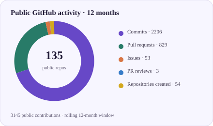
  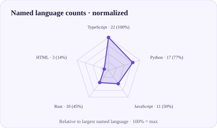
  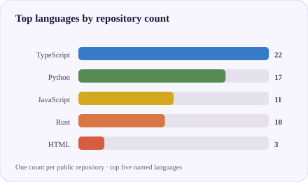

Public GitHub activity and repository stats refresh daily. Activity counts are not a measure of code quality or project impact. Each public repository counts once by its primary language; language charts do not represent code volume, skill, or time spent.

## Featured projects

These are the main threads running through my work: AI infrastructure, deterministic tooling, and developer infrastructure.

<!-- profile-featured:start -->
| Project | Category | Status | Summary |
| --- | --- | --- | --- |
| [Amortyx](https://github.com/aliasfoxkde/Amortyx) · [Live site](https://amortyx.com/) | AI infrastructure | Active development | Local-first Rust router for coding-agent traffic, provider routing, prompt optimization, and usage observability. |
| [OpenCodifier](https://github.com/aliasfoxkde/OpenCodifier) · [Live site](https://opencodifier.pages.dev/) | AI infrastructure | Active development | Deterministic-first local decision runtime with CLI, HTTP, MCP, and WASM interfaces. |
| [AgentVerify](https://github.com/aliasfoxkde/AgentVerify) | AI infrastructure | Needs review | Outcome verification for action-taking agents, with explicit uncertainty states and evidence receipts. |
| [Aegis](https://github.com/aliasfoxkde/aegis) | Developer infrastructure | Needs review | Rust security scanning for repositories, CI/CD, and AI-assisted development. |
| [GitForge](https://github.com/aliasfoxkde/GitForge) | Developer infrastructure | Active development | Self-hosted Git hosting and event-driven CI/CD platform. |
| [Dark Factory](https://github.com/aliasfoxkde/dark-factory) | Developer infrastructure | Needs review | AI-first repository template and development workflow. |
<!-- profile-featured:end -->

Project status and summaries are generated from [projects.json](projects.json). The visual demo gallery below is curated separately so screenshots can be reviewed independently.

## Live projects & demos

<table>
  <tr>
    <td width="33.33%" align="center">
      <a href="https://amortyx.com/">
        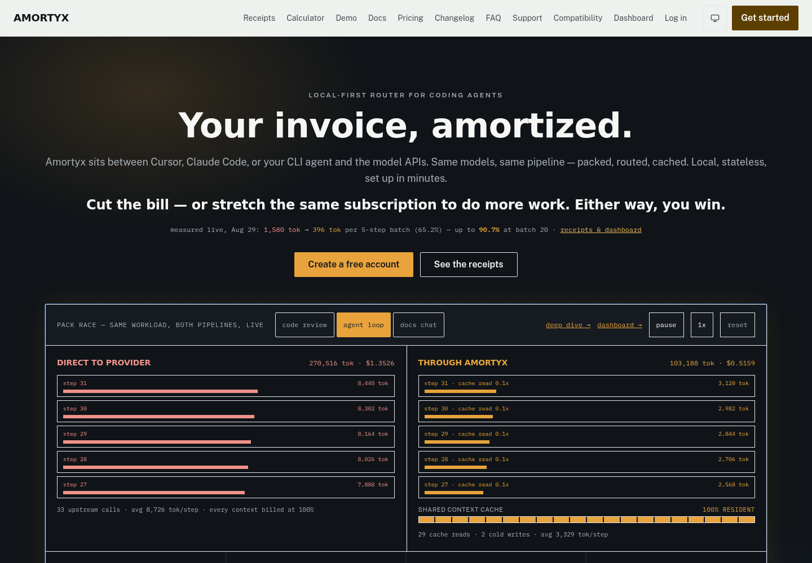
      </a>
       
      <strong><a href="https://amortyx.com/">Amortyx</a></strong> 
      AI request optimization, enforcement, and model routing.
    </td>
    <td width="33.33%" align="center">
      <a href="https://openzenith.org/">
        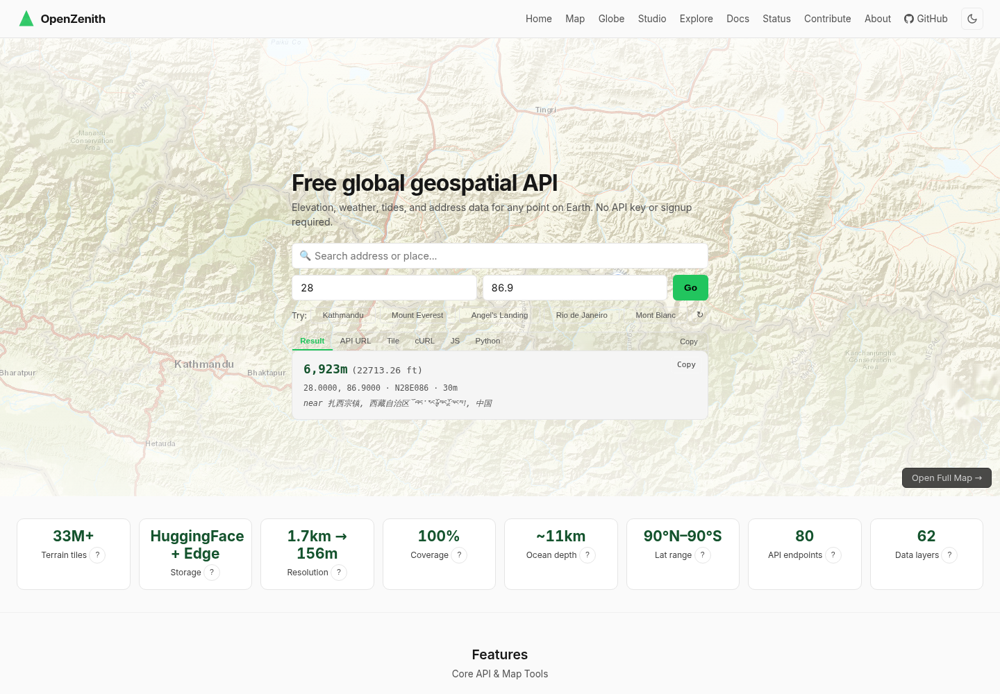
      </a>
       
      <strong><a href="https://openzenith.org/">OpenZenith</a></strong> 
      Open elevation data, geospatial APIs, and mapping tools.
    </td>
    <td width="33.33%" align="center">
      <a href="https://artcraft-webos.pages.dev/">
        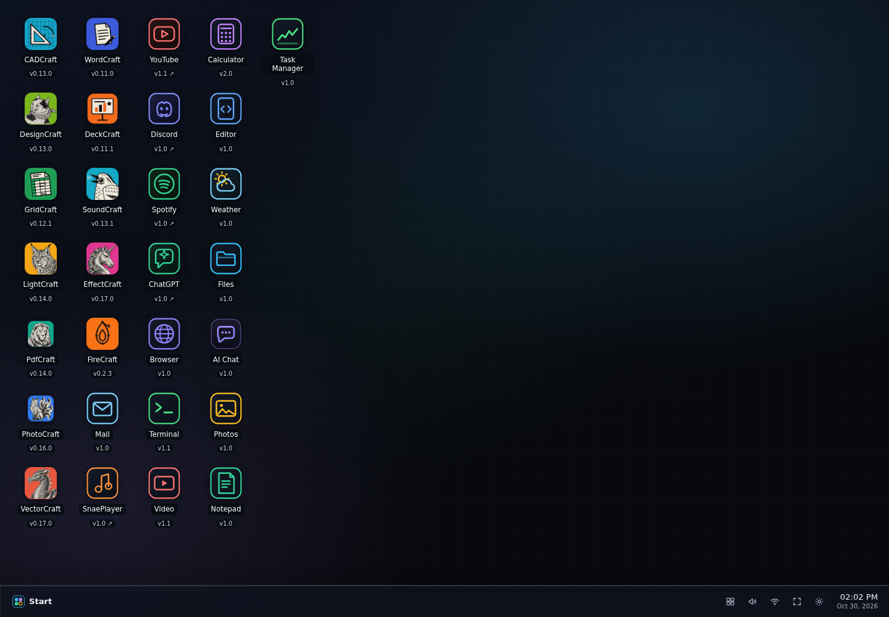
      </a>
       
      <strong><a href="https://artcraft-webos.pages.dev/">ArtCraft WebOS</a></strong> 
      A browser desktop concept for creative applications.
    </td>
  </tr>
  <tr>
    <td width="33.33%" align="center">
      <a href="https://stationawareness.pages.dev/">
        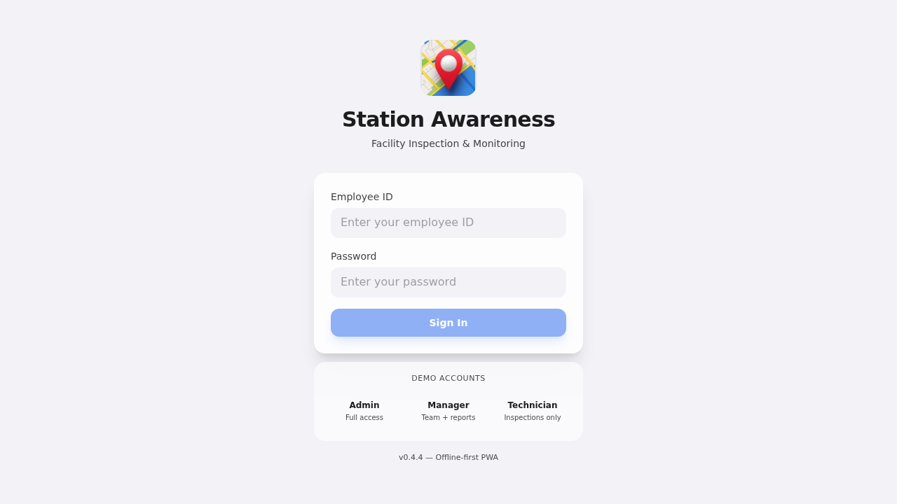
      </a>
       
      <strong><a href="https://stationawareness.pages.dev/">Station Awareness</a></strong> 
      Offline-first facility inspection and monitoring.
    </td>
    <td width="33.33%" align="center">
      <a href="https://taskwizer-landing.pages.dev/">
        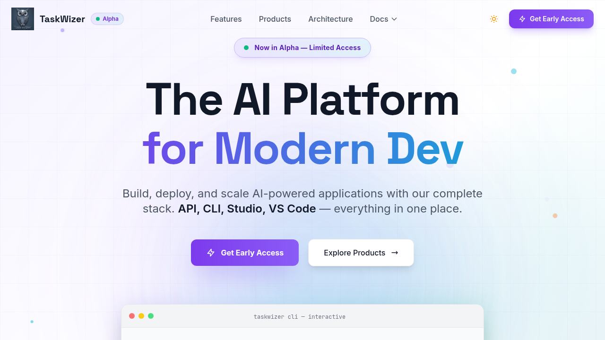
      </a>
       
      <strong><a href="https://taskwizer-landing.pages.dev/">TaskWizer</a></strong> 
      An AI development platform for planning and shipping software.
    </td>
    <td width="33.33%" align="center">
      <a href="https://studio-taskwizer.pages.dev/">
        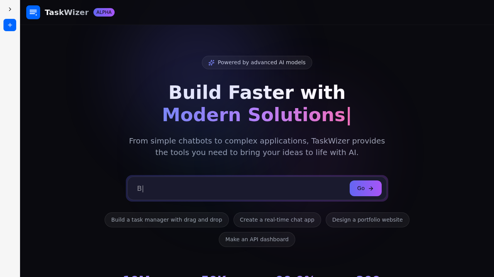
      </a>
       
      <strong><a href="https://studio-taskwizer.pages.dev/">TaskWizer Studio</a></strong> 
      A browser workspace for AI-powered applications and workflows.
    </td>
  </tr>
  <tr>
    <td width="33.33%" align="center">
      <a href="https://scratch-optimizer.pages.dev/">
        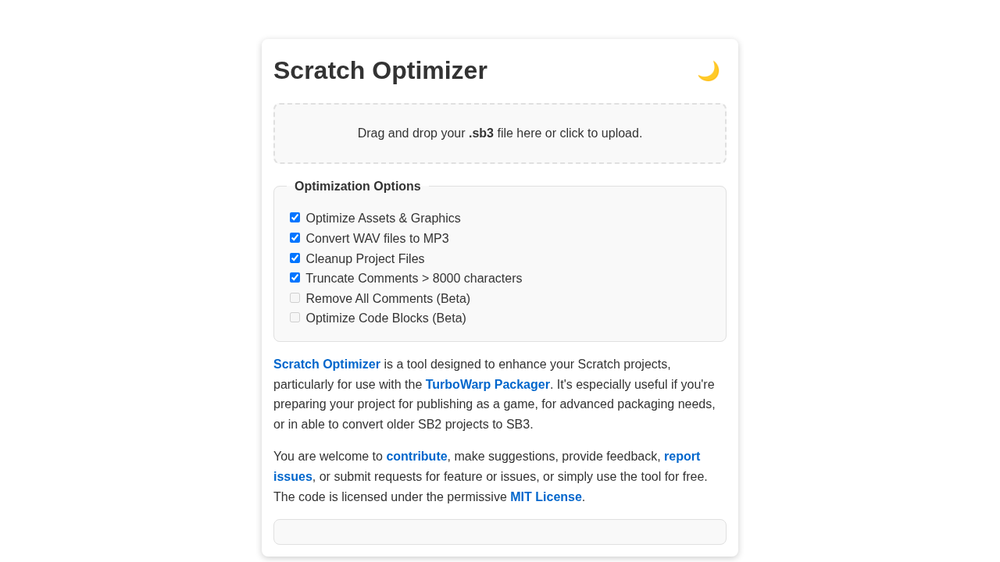
      </a>
       
      <strong><a href="https://scratch-optimizer.pages.dev/">Scratch Optimizer</a></strong> 
      Clean and optimize Scratch projects before sharing.
    </td>
    <td width="33.33%" align="center">
      <a href="https://bolt-main.pages.dev/">
        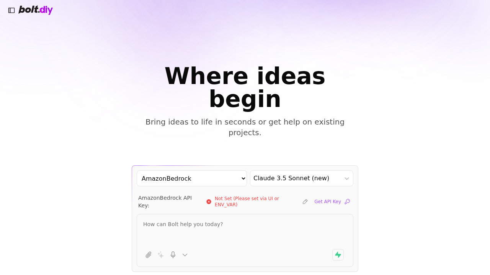
      </a>
       
      <strong><a href="https://bolt-main.pages.dev/">Bolt</a></strong> 
      Browser-based AI app prototyping; a provider API key is required.
    </td>
    <td width="33.33%" align="center">
      <a href="https://onnx-chat.pages.dev/">
        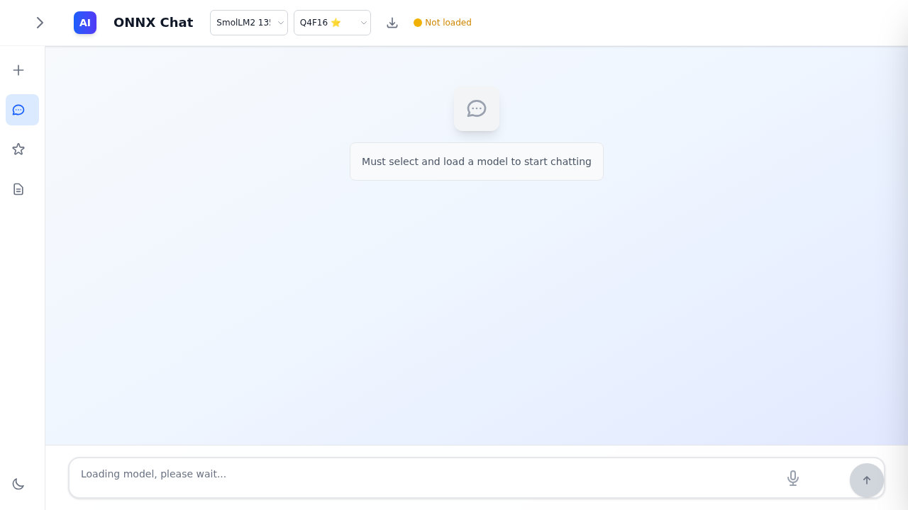
      </a>
       
      <strong><a href="https://onnx-chat.pages.dev/">ONNX Chat</a></strong> 
      Browser chat for ONNX models with tools and notes.
    </td>
  </tr>
  <tr>
    <td width="33.33%" align="center">
      
       
      <strong><a href="https://prisai-cha.pages.dev/">PRISAI</a></strong> 
      Property-records intelligence system; public demo sign-in required.
    </td>
    <td width="33.33%" align="center">
      <a href="https://siliconrank.pages.dev/">
        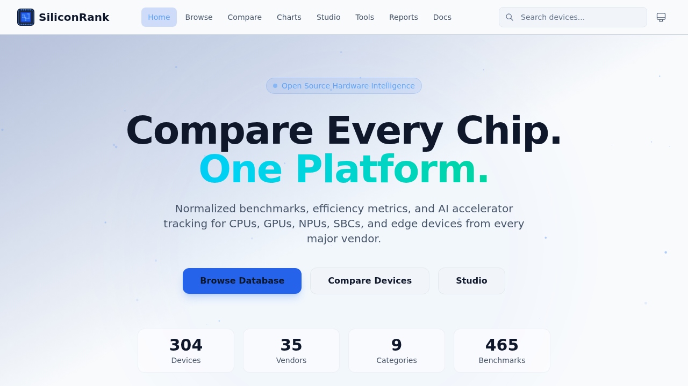
      </a>
       
      <strong><a href="https://siliconrank.pages.dev/">SiliconRank</a></strong> 
      Compare CPUs, GPUs, and AI accelerators with open hardware data.
    </td>
    <td width="33.33%" align="center">
      <a href="https://opencodifier.pages.dev/">
        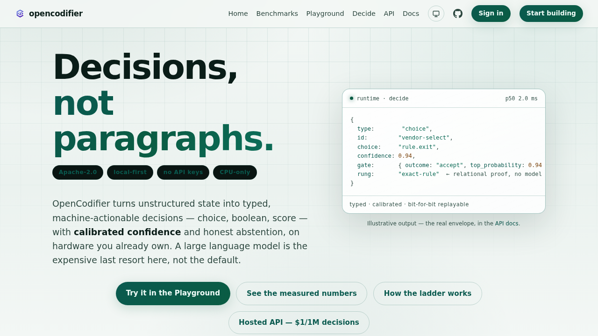
      </a>
       
      <strong><a href="https://opencodifier.pages.dev/">OpenCodifier</a></strong> 
      Fast, local-first code intelligence and decision tooling.
    </td>
  </tr>
</table>

  <a href="https://aliasfoxkde.github.io/">Website</a> ·
  <a href="https://aliasfoxkde.github.io/examples/">Interactive demos</a> ·
  <a href="https://github.com/aliasfoxkde/aliasfoxkde/tree/main/examples">Reusable examples</a> ·
  <a href="https://github.com/aliasfoxkde/aliasfoxkde/blob/main/AGENTS.md">Agent guidance</a> ·
  <a href="https://github.com/aliasfoxkde?tab=repositories">All repositories</a> ·
  <a href="https://github.com/sponsors/aliasfoxkde">Sponsor open-source work</a>

The profile README source includes a cloneable [`examples/`](./examples/) gallery with local screenshots, interactive profile widgets, reusable SVG templates, and design notes. Clone the repository and follow its [local preview instructions](./examples/README.md); coding agents can use the repository guidance in [`AGENTS.md`](./AGENTS.md).

## Open-source projects

<!-- profile-projects:start -->

  
Show all 33 public project repositories

Refreshed daily from GitHub. Archived and empty repositories are identified from GitHub metadata; curated maturity labels and summaries come from <a href="projects.json">projects.json</a>. Unclassified repositories are marked Needs review rather than assumed active. Forks are excluded.

<table>
  <thead><tr><th>Project</th><th>Primary language</th><th>Status</th><th>About</th></tr></thead>
  <tbody>
    <tr><td><a href="https://github.com/aliasfoxkde/aegis">aegis</a> · <a href="https://github.com/copilot/app/launch?open=ghapp%3A%2F%2Fsession%2Fnew%3Frepo%3Daliasfoxkde%252Faegis%26mode%3Dinteractive%26prompt%3DGive%2520me%2520a%2520concise%2520overview%2520of%2520this%2520repository%253A%2520its%2520purpose%252C%2520key%2520components%252C%2520technologies%252C%2520and%2520how%2520to%2520get%2520started.">Ask Copilot</a></td><td>Rust</td><td>Needs review</td><td>Rust security scanning for repositories, CI/CD, and AI-assisted development.</td></tr>
    <tr><td><a href="https://github.com/aliasfoxkde/AgentVerify">AgentVerify</a> · <a href="https://github.com/copilot/app/launch?open=ghapp%3A%2F%2Fsession%2Fnew%3Frepo%3Daliasfoxkde%252FAgentVerify%26mode%3Dinteractive%26prompt%3DGive%2520me%2520a%2520concise%2520overview%2520of%2520this%2520repository%253A%2520its%2520purpose%252C%2520key%2520components%252C%2520technologies%252C%2520and%2520how%2520to%2520get%2520started.">Ask Copilot</a></td><td>Rust</td><td>Needs review</td><td>Outcome verification for action-taking agents, with explicit uncertainty states and evidence receipts.</td></tr>
    <tr><td><a href="https://github.com/aliasfoxkde/AI-SVG-Creator">AI-SVG-Creator</a> · <a href="https://github.com/copilot/app/launch?open=ghapp%3A%2F%2Fsession%2Fnew%3Frepo%3Daliasfoxkde%252FAI-SVG-Creator%26mode%3Dinteractive%26prompt%3DGive%2520me%2520a%2520concise%2520overview%2520of%2520this%2520repository%253A%2520its%2520purpose%252C%2520key%2520components%252C%2520technologies%252C%2520and%2520how%2520to%2520get%2520started.">Ask Copilot</a></td><td>Python</td><td>Experimental</td><td>Early Hugging Face-backed SVG generation experiment; Python and legacy browser workflows are not yet integrated or verified runnable.</td></tr>
    <tr><td><a href="https://github.com/aliasfoxkde/aliasfoxkde">aliasfoxkde</a> · <a href="https://github.com/copilot/app/launch?open=ghapp%3A%2F%2Fsession%2Fnew%3Frepo%3Daliasfoxkde%252Faliasfoxkde%26mode%3Dinteractive%26prompt%3DGive%2520me%2520a%2520concise%2520overview%2520of%2520this%2520repository%253A%2520its%2520purpose%252C%2520key%2520components%252C%2520technologies%252C%2520and%2520how%2520to%2520get%2520started.">Ask Copilot</a></td><td>Python</td><td>Needs review</td><td>GitHub profile README for Aliasfoxkde.</td></tr>
    <tr><td><a href="https://github.com/aliasfoxkde/aliasfoxkde.github.io">aliasfoxkde.github.io</a> · <a href="https://github.com/copilot/app/launch?open=ghapp%3A%2F%2Fsession%2Fnew%3Frepo%3Daliasfoxkde%252Faliasfoxkde.github.io%26mode%3Dinteractive%26prompt%3DGive%2520me%2520a%2520concise%2520overview%2520of%2520this%2520repository%253A%2520its%2520purpose%252C%2520key%2520components%252C%2520technologies%252C%2520and%2520how%2520to%2520get%2520started.">Ask Copilot</a></td><td>HTML</td><td>Internal / support</td><td>Personal website and live-demo gallery; reconcile canonical project URLs and ownership with OpenPortfolio.</td></tr>
    <tr><td><a href="https://github.com/aliasfoxkde/ArtCraft-WebOS">ArtCraft-WebOS</a> · <a href="https://github.com/copilot/app/launch?open=ghapp%3A%2F%2Fsession%2Fnew%3Frepo%3Daliasfoxkde%252FArtCraft-WebOS%26mode%3Dinteractive%26prompt%3DGive%2520me%2520a%2520concise%2520overview%2520of%2520this%2520repository%253A%2520its%2520purpose%252C%2520key%2520components%252C%2520technologies%252C%2520and%2520how%2520to%2520get%2520started.">Ask Copilot</a></td><td>JavaScript</td><td>Prototype</td><td>Browser-based desktop/WebOS prototype for launching WASM apps in a desktop-like workspace; AI-native expansion is planned, not yet complete.</td></tr>
    <tr><td><a href="https://github.com/aliasfoxkde/Atheon-Benchmark">Atheon-Benchmark</a> · <a href="https://github.com/copilot/app/launch?open=ghapp%3A%2F%2Fsession%2Fnew%3Frepo%3Daliasfoxkde%252FAtheon-Benchmark%26mode%3Dinteractive%26prompt%3DGive%2520me%2520a%2520concise%2520overview%2520of%2520this%2520repository%253A%2520its%2520purpose%252C%2520key%2520components%252C%2520technologies%252C%2520and%2520how%2520to%2520get%2520started.">Ask Copilot</a></td><td>TypeScript</td><td>Archived</td><td>Archived benchmark project retained for historical reference.</td></tr>
    <tr><td><a href="https://github.com/aliasfoxkde/Atheon-Scanner">Atheon-Scanner</a> · <a href="https://github.com/copilot/app/launch?open=ghapp%3A%2F%2Fsession%2Fnew%3Frepo%3Daliasfoxkde%252FAtheon-Scanner%26mode%3Dinteractive%26prompt%3DGive%2520me%2520a%2520concise%2520overview%2520of%2520this%2520repository%253A%2520its%2520purpose%252C%2520key%2520components%252C%2520technologies%252C%2520and%2520how%2520to%2520get%2520started.">Ask Copilot</a></td><td>HTML</td><td>Archived</td><td>Archived scanner project; historical dependencies and placeholder clone references should not be treated as current.</td></tr>
    <tr><td><a href="https://github.com/aliasfoxkde/back4app_vscode_integration">back4app_vscode_integration</a> · <a href="https://github.com/copilot/app/launch?open=ghapp%3A%2F%2Fsession%2Fnew%3Frepo%3Daliasfoxkde%252Fback4app_vscode_integration%26mode%3Dinteractive%26prompt%3DGive%2520me%2520a%2520concise%2520overview%2520of%2520this%2520repository%253A%2520its%2520purpose%252C%2520key%2520components%252C%2520technologies%252C%2520and%2520how%2520to%2520get%2520started.">Ask Copilot</a></td><td>TypeScript</td><td>Prototype</td><td>Early VS Code integration prototype; confirm current compatibility and maintenance status before recommending.</td></tr>
    <tr><td><a href="https://github.com/aliasfoxkde/blender-wasm">blender-wasm</a> · <a href="https://github.com/copilot/app/launch?open=ghapp%3A%2F%2Fsession%2Fnew%3Frepo%3Daliasfoxkde%252Fblender-wasm%26mode%3Dinteractive%26prompt%3DGive%2520me%2520a%2520concise%2520overview%2520of%2520this%2520repository%253A%2520its%2520purpose%252C%2520key%2520components%252C%2520technologies%252C%2520and%2520how%2520to%2520get%2520started.">Ask Copilot</a></td><td>TypeScript</td><td>Prototype</td><td>Browser desktop/PWA scaffold; Blender core integration is not yet complete.</td></tr>
    <tr><td><a href="https://github.com/aliasfoxkde/bolt-terminal">bolt-terminal</a> · <a href="https://github.com/copilot/app/launch?open=ghapp%3A%2F%2Fsession%2Fnew%3Frepo%3Daliasfoxkde%252Fbolt-terminal%26mode%3Dinteractive%26prompt%3DGive%2520me%2520a%2520concise%2520overview%2520of%2520this%2520repository%253A%2520its%2520purpose%252C%2520key%2520components%252C%2520technologies%252C%2520and%2520how%2520to%2520get%2520started.">Ask Copilot</a></td><td>JavaScript</td><td>Prototype</td><td>Browser terminal environment with a Pyodide-based Python runtime.</td></tr>
    <tr><td><a href="https://github.com/aliasfoxkde/Buy_A_Buddy">Buy_A_Buddy</a> · <a href="https://github.com/copilot/app/launch?open=ghapp%3A%2F%2Fsession%2Fnew%3Frepo%3Daliasfoxkde%252FBuy_A_Buddy%26mode%3Dinteractive%26prompt%3DGive%2520me%2520a%2520concise%2520overview%2520of%2520this%2520repository%253A%2520its%2520purpose%252C%2520key%2520components%252C%2520technologies%252C%2520and%2520how%2520to%2520get%2520started.">Ask Copilot</a></td><td>TypeScript</td><td>Needs review</td><td>2D RPG with buddies, farming, turn-based battles, and mini-games; validate current gameplay, saves, and mobile compatibility.</td></tr>
    <tr><td><a href="https://github.com/aliasfoxkde/cinematic-template-composer">cinematic-template-composer</a> · <a href="https://github.com/copilot/app/launch?open=ghapp%3A%2F%2Fsession%2Fnew%3Frepo%3Daliasfoxkde%252Fcinematic-template-composer%26mode%3Dinteractive%26prompt%3DGive%2520me%2520a%2520concise%2520overview%2520of%2520this%2520repository%253A%2520its%2520purpose%252C%2520key%2520components%252C%2520technologies%252C%2520and%2520how%2520to%2520get%2520started.">Ask Copilot</a></td><td>TypeScript</td><td>Needs review</td><td>Cinematic prompt composer with themed templates and ComfyUI dispatch; verify API requirements, asset provenance, and offline behavior.</td></tr>
    <tr><td><a href="https://github.com/aliasfoxkde/Codewars">Codewars</a> · <a href="https://github.com/copilot/app/launch?open=ghapp%3A%2F%2Fsession%2Fnew%3Frepo%3Daliasfoxkde%252FCodewars%26mode%3Dinteractive%26prompt%3DGive%2520me%2520a%2520concise%2520overview%2520of%2520this%2520repository%253A%2520its%2520purpose%252C%2520key%2520components%252C%2520technologies%252C%2520and%2520how%2520to%2520get%2520started.">Ask Copilot</a></td><td>—</td><td>Empty / placeholder</td><td>Repository appeared empty in the portfolio audit; confirm whether it should remain public or be removed from the inventory.</td></tr>
    <tr><td><a href="https://github.com/aliasfoxkde/dark-factory">dark-factory</a> · <a href="https://github.com/copilot/app/launch?open=ghapp%3A%2F%2Fsession%2Fnew%3Frepo%3Daliasfoxkde%252Fdark-factory%26mode%3Dinteractive%26prompt%3DGive%2520me%2520a%2520concise%2520overview%2520of%2520this%2520repository%253A%2520its%2520purpose%252C%2520key%2520components%252C%2520technologies%252C%2520and%2520how%2520to%2520get%2520started.">Ask Copilot</a></td><td>Makefile</td><td>Needs review</td><td>AI-first repository template and development workflow.</td></tr>
    <tr><td><a href="https://github.com/aliasfoxkde/DevOpsRPG">DevOpsRPG</a> · <a href="https://github.com/copilot/app/launch?open=ghapp%3A%2F%2Fsession%2Fnew%3Frepo%3Daliasfoxkde%252FDevOpsRPG%26mode%3Dinteractive%26prompt%3DGive%2520me%2520a%2520concise%2520overview%2520of%2520this%2520repository%253A%2520its%2520purpose%252C%2520key%2520components%252C%2520technologies%252C%2520and%2520how%2520to%2520get%2520started.">Ask Copilot</a></td><td>TypeScript</td><td>Needs review</td><td>Gamified DevOps learning experience; verify the published test count, curriculum coverage, and current deployment.</td></tr>
    <tr><td><a href="https://github.com/aliasfoxkde/FireCraft">FireCraft</a> · <a href="https://github.com/copilot/app/launch?open=ghapp%3A%2F%2Fsession%2Fnew%3Frepo%3Daliasfoxkde%252FFireCraft%26mode%3Dinteractive%26prompt%3DGive%2520me%2520a%2520concise%2520overview%2520of%2520this%2520repository%253A%2520its%2520purpose%252C%2520key%2520components%252C%2520technologies%252C%2520and%2520how%2520to%2520get%2520started.">Ask Copilot</a></td><td>Rust</td><td>Active development</td><td>Rust vector/bitmap graphics editor with a Fireworks PNG document model, deterministic CPU rendering, and WASM/native targets.</td></tr>
    <tr><td><a href="https://github.com/aliasfoxkde/GitForge">GitForge</a> · <a href="https://github.com/copilot/app/launch?open=ghapp%3A%2F%2Fsession%2Fnew%3Frepo%3Daliasfoxkde%252FGitForge%26mode%3Dinteractive%26prompt%3DGive%2520me%2520a%2520concise%2520overview%2520of%2520this%2520repository%253A%2520its%2520purpose%252C%2520key%2520components%252C%2520technologies%252C%2520and%2520how%2520to%2520get%2520started.">Ask Copilot</a></td><td>Rust</td><td>Active development</td><td>Self-hosted Git hosting and event-driven CI/CD platform.</td></tr>
    <tr><td><a href="https://github.com/aliasfoxkde/hermes-workspace-deploy">hermes-workspace-deploy</a> · <a href="https://github.com/copilot/app/launch?open=ghapp%3A%2F%2Fsession%2Fnew%3Frepo%3Daliasfoxkde%252Fhermes-workspace-deploy%26mode%3Dinteractive%26prompt%3DGive%2520me%2520a%2520concise%2520overview%2520of%2520this%2520repository%253A%2520its%2520purpose%252C%2520key%2520components%252C%2520technologies%252C%2520and%2520how%2520to%2520get%2520started.">Ask Copilot</a></td><td>Shell</td><td>Internal / support</td><td>Deployment and operations support repository; keep operational identifiers and credential-adjacent details sanitized.</td></tr>
    <tr><td><a href="https://github.com/aliasfoxkde/kona">kona</a> · <a href="https://github.com/copilot/app/launch?open=ghapp%3A%2F%2Fsession%2Fnew%3Frepo%3Daliasfoxkde%252Fkona%26mode%3Dinteractive%26prompt%3DGive%2520me%2520a%2520concise%2520overview%2520of%2520this%2520repository%253A%2520its%2520purpose%252C%2520key%2520components%252C%2520technologies%252C%2520and%2520how%2520to%2520get%2520started.">Ask Copilot</a></td><td>JavaScript</td><td>Experimental</td><td>Small CLI wrapper around a Sudoku demo API; document API availability and expected behavior.</td></tr>
    <tr><td><a href="https://github.com/aliasfoxkde/min3js">min3js</a> · <a href="https://github.com/copilot/app/launch?open=ghapp%3A%2F%2Fsession%2Fnew%3Frepo%3Daliasfoxkde%252Fmin3js%26mode%3Dinteractive%26prompt%3DGive%2520me%2520a%2520concise%2520overview%2520of%2520this%2520repository%253A%2520its%2520purpose%252C%2520key%2520components%252C%2520technologies%252C%2520and%2520how%2520to%2520get%2520started.">Ask Copilot</a></td><td>JavaScript</td><td>Fork / mirror</td><td>Three.js-derived repository; verify upstream relationship, local changes, and attribution before presenting as an original project.</td></tr>
    <tr><td><a href="https://github.com/aliasfoxkde/minecraft">minecraft</a> · <a href="https://github.com/copilot/app/launch?open=ghapp%3A%2F%2Fsession%2Fnew%3Frepo%3Daliasfoxkde%252Fminecraft%26mode%3Dinteractive%26prompt%3DGive%2520me%2520a%2520concise%2520overview%2520of%2520this%2520repository%253A%2520its%2520purpose%252C%2520key%2520components%252C%2520technologies%252C%2520and%2520how%2520to%2520get%2520started.">Ask Copilot</a></td><td>HTML</td><td>Fork / mirror</td><td>Eaglercraft-related repository; verify upstream relationship, license, and redistribution rights before presenting as an original project.</td></tr>
    <tr><td><a href="https://github.com/aliasfoxkde/OpenCAD">OpenCAD</a> · <a href="https://github.com/copilot/app/launch?open=ghapp%3A%2F%2Fsession%2Fnew%3Frepo%3Daliasfoxkde%252FOpenCAD%26mode%3Dinteractive%26prompt%3DGive%2520me%2520a%2520concise%2520overview%2520of%2520this%2520repository%253A%2520its%2520purpose%252C%2520key%2520components%252C%2520technologies%252C%2520and%2520how%2520to%2520get%2520started.">Ask Copilot</a></td><td>TypeScript</td><td>Needs review</td><td>Browser-native parametric CAD prototype using custom TypeScript triangle-mesh generators and CSG; no OpenCASCADE/B-rep kernel or STEP/IGES support is currently included.</td></tr>
    <tr><td><a href="https://github.com/aliasfoxkde/OpenCodifier">OpenCodifier</a> · <a href="https://github.com/copilot/app/launch?open=ghapp%3A%2F%2Fsession%2Fnew%3Frepo%3Daliasfoxkde%252FOpenCodifier%26mode%3Dinteractive%26prompt%3DGive%2520me%2520a%2520concise%2520overview%2520of%2520this%2520repository%253A%2520its%2520purpose%252C%2520key%2520components%252C%2520technologies%252C%2520and%2520how%2520to%2520get%2520started.">Ask Copilot</a></td><td>Rust</td><td>Active development</td><td>Deterministic-first local decision runtime with CLI, HTTP, MCP, and WASM interfaces.</td></tr>
    <tr><td><a href="https://github.com/aliasfoxkde/OpenPortfolio">OpenPortfolio</a> · <a href="https://github.com/copilot/app/launch?open=ghapp%3A%2F%2Fsession%2Fnew%3Frepo%3Daliasfoxkde%252FOpenPortfolio%26mode%3Dinteractive%26prompt%3DGive%2520me%2520a%2520concise%2520overview%2520of%2520this%2520repository%253A%2520its%2520purpose%252C%2520key%2520components%252C%2520technologies%252C%2520and%2520how%2520to%2520get%2520started.">Ask Copilot</a></td><td>TypeScript</td><td>Needs review</td><td>Portfolio aggregation application; canonical relationship to the profile website requires review.</td></tr>
    <tr><td><a href="https://github.com/aliasfoxkde/OpenPress">OpenPress</a> · <a href="https://github.com/copilot/app/launch?open=ghapp%3A%2F%2Fsession%2Fnew%3Frepo%3Daliasfoxkde%252FOpenPress%26mode%3Dinteractive%26prompt%3DGive%2520me%2520a%2520concise%2520overview%2520of%2520this%2520repository%253A%2520its%2520purpose%252C%2520key%2520components%252C%2520technologies%252C%2520and%2520how%2520to%2520get%2520started.">Ask Copilot</a></td><td>TypeScript</td><td>Needs review</td><td>Cloudflare-native CMS and web application platform; verify authentication, media, storefront, backup, and deployment limits before production claims.</td></tr>
    <tr><td><a href="https://github.com/aliasfoxkde/OpenZenith">OpenZenith</a> · <a href="https://github.com/copilot/app/launch?open=ghapp%3A%2F%2Fsession%2Fnew%3Frepo%3Daliasfoxkde%252FOpenZenith%26mode%3Dinteractive%26prompt%3DGive%2520me%2520a%2520concise%2520overview%2520of%2520this%2520repository%253A%2520its%2520purpose%252C%2520key%2520components%252C%2520technologies%252C%2520and%2520how%2520to%2520get%2520started.">Ask Copilot</a></td><td>TypeScript</td><td>Needs review</td><td>Geospatial SDK and APIs for elevation and terrain data.</td></tr>
    <tr><td><a href="https://github.com/aliasfoxkde/py7zip">py7zip</a> · <a href="https://github.com/copilot/app/launch?open=ghapp%3A%2F%2Fsession%2Fnew%3Frepo%3Daliasfoxkde%252Fpy7zip%26mode%3Dinteractive%26prompt%3DGive%2520me%2520a%2520concise%2520overview%2520of%2520this%2520repository%253A%2520its%2520purpose%252C%2520key%2520components%252C%2520technologies%252C%2520and%2520how%2520to%2520get%2520started.">Ask Copilot</a></td><td>Python</td><td>Needs review</td><td>Python 7-Zip wrapper; verify published package version, supported platforms, binary provenance, and licensing.</td></tr>
    <tr><td><a href="https://github.com/aliasfoxkde/RandomChallenges">RandomChallenges</a> · <a href="https://github.com/copilot/app/launch?open=ghapp%3A%2F%2Fsession%2Fnew%3Frepo%3Daliasfoxkde%252FRandomChallenges%26mode%3Dinteractive%26prompt%3DGive%2520me%2520a%2520concise%2520overview%2520of%2520this%2520repository%253A%2520its%2520purpose%252C%2520key%2520components%252C%2520technologies%252C%2520and%2520how%2520to%2520get%2520started.">Ask Copilot</a></td><td>Python</td><td>Experimental</td><td>Collection of learning exercises and programming challenges.</td></tr>
    <tr><td><a href="https://github.com/aliasfoxkde/scratch-optimizer">scratch-optimizer</a> · <a href="https://github.com/copilot/app/launch?open=ghapp%3A%2F%2Fsession%2Fnew%3Frepo%3Daliasfoxkde%252Fscratch-optimizer%26mode%3Dinteractive%26prompt%3DGive%2520me%2520a%2520concise%2520overview%2520of%2520this%2520repository%253A%2520its%2520purpose%252C%2520key%2520components%252C%2520technologies%252C%2520and%2520how%2520to%2520get%2520started.">Ask Copilot</a></td><td>JavaScript</td><td>Active development</td><td>Browser-based tooling for inspecting and optimizing Scratch projects.</td></tr>
    <tr><td><a href="https://github.com/aliasfoxkde/SiliconRank">SiliconRank</a> · <a href="https://github.com/copilot/app/launch?open=ghapp%3A%2F%2Fsession%2Fnew%3Frepo%3Daliasfoxkde%252FSiliconRank%26mode%3Dinteractive%26prompt%3DGive%2520me%2520a%2520concise%2520overview%2520of%2520this%2520repository%253A%2520its%2520purpose%252C%2520key%2520components%252C%2520technologies%252C%2520and%2520how%2520to%2520get%2520started.">Ask Copilot</a></td><td>TypeScript</td><td>Needs review</td><td>Hardware intelligence and normalized benchmark comparison.</td></tr>
    <tr><td><a href="https://github.com/aliasfoxkde/snippets">snippets</a> · <a href="https://github.com/copilot/app/launch?open=ghapp%3A%2F%2Fsession%2Fnew%3Frepo%3Daliasfoxkde%252Fsnippets%26mode%3Dinteractive%26prompt%3DGive%2520me%2520a%2520concise%2520overview%2520of%2520this%2520repository%253A%2520its%2520purpose%252C%2520key%2520components%252C%2520technologies%252C%2520and%2520how%2520to%2520get%2520started.">Ask Copilot</a></td><td>Python</td><td>Experimental</td><td>Personal code snippets and learning examples; add an index and clarify licensing.</td></tr>
    <tr><td><a href="https://github.com/aliasfoxkde/template">template</a> · <a href="https://github.com/copilot/app/launch?open=ghapp%3A%2F%2Fsession%2Fnew%3Frepo%3Daliasfoxkde%252Ftemplate%26mode%3Dinteractive%26prompt%3DGive%2520me%2520a%2520concise%2520overview%2520of%2520this%2520repository%253A%2520its%2520purpose%252C%2520key%2520components%252C%2520technologies%252C%2520and%2520how%2520to%2520get%2520started.">Ask Copilot</a></td><td>Python</td><td>Needs review</td><td>Legacy project template with update scripts that may overwrite local data; compare with Dark Factory before recommending.</td></tr>
  </tbody>
</table>

<!-- profile-projects:end -->

## Organizations

  <a href="https://github.com/Cyopsys">Cyopsys</a> ·
  <a href="https://github.com/stackblitz-labs">StackBlitz Labs</a> ·
  <a href="https://github.com/WizerAI">WizerAI</a> ·
  <a href="https://github.com/AI-CRUD-Sandbox">AI-CRUD-Sandbox</a> ·
  <a href="https://github.com/TaskWizer">TaskWizer</a> ·
  <a href="https://github.com/MiniDevPlatform">MiniDevPlatform</a>

## Interests

- **AI and machine learning:** agent systems, model routing, local inference,
  and making AI workflows more capable and efficient.
- **Software, DevOps, and infrastructure:** Rust, APIs, developer tools,
  CI/CD, deployment automation, self-hosted services, and local-first systems.
- **Data and connected systems:** geospatial computing, elevation data,
  mapping, IoT, and connected-device workflows.
- **Art and creative computing:** traditional and digital art, drawing,
  design, and browser-based creative applications.
- **Engineering practice:** process improvement, automation, reproducible
  workflows, and technical writing.

## Things I code with

  
  
  
  
  
  
  
  
  

## Special thanks

I’m grateful to everyone who supports my open-source work. This list refreshes daily and includes only active sponsorships that sponsors have chosen to make public; private sponsorships and contribution amounts are never shown.

<!-- profile-sponsors:start -->
**0 public sponsors so far.** If you find my open-source work useful, [sponsor me on GitHub](https://github.com/sponsors/aliasfoxkde). Thank you for considering it.
<!-- profile-sponsors:end -->

## Followers

These are public GitHub accounts that follow this profile. The list refreshes daily.

<!-- profile-followers:start -->
<a href="https://github.com/agent7744"><code>@agent7744</code></a>, <a href="https://github.com/anurag-garg01"><code>@anurag-garg01</code></a>, <a href="https://github.com/ask0ldd"><code>@ask0ldd</code></a>, <a href="https://github.com/bludnic"><code>@bludnic</code></a>, <a href="https://github.com/CoreyLeath-code"><code>@CoreyLeath-code</code></a>, <a href="https://github.com/dustinwloring1988"><code>@dustinwloring1988</code></a>, <a href="https://github.com/Dvurechensky"><code>@Dvurechensky</code></a>, <a href="https://github.com/Focus-andmore"><code>@Focus-andmore</code></a>,
<a href="https://github.com/Garhiou"><code>@Garhiou</code></a>, <a href="https://github.com/GoMightyAlgorythmGo"><code>@GoMightyAlgorythmGo</code></a>, <a href="https://github.com/hafiznega4-boo"><code>@hafiznega4-boo</code></a>, <a href="https://github.com/ipqwery"><code>@ipqwery</code></a>, <a href="https://github.com/ishandutta2007"><code>@ishandutta2007</code></a>, <a href="https://github.com/Jawuilp"><code>@Jawuilp</code></a>, <a href="https://github.com/jelspace"><code>@jelspace</code></a>, <a href="https://github.com/JustVugg"><code>@JustVugg</code></a>,
<a href="https://github.com/Kirachon"><code>@Kirachon</code></a>, <a href="https://github.com/kpopdev"><code>@kpopdev</code></a>, <a href="https://github.com/lecanact"><code>@lecanact</code></a>, <a href="https://github.com/lukisch"><code>@lukisch</code></a>, <a href="https://github.com/lvs0"><code>@lvs0</code></a>, <a href="https://github.com/mbelalhossain718-cpu"><code>@mbelalhossain718-cpu</code></a>, <a href="https://github.com/micasa96"><code>@micasa96</code></a>, <a href="https://github.com/Murplugg"><code>@Murplugg</code></a>,
<a href="https://github.com/OriNachum"><code>@OriNachum</code></a>, <a href="https://github.com/peytondsay"><code>@peytondsay</code></a>, <a href="https://github.com/poormikey80-create"><code>@poormikey80-create</code></a>, <a href="https://github.com/pwnedroot"><code>@pwnedroot</code></a>, <a href="https://github.com/RaduNG"><code>@RaduNG</code></a>, <a href="https://github.com/RemoteBrowser01"><code>@RemoteBrowser01</code></a>, <a href="https://github.com/ssoad"><code>@ssoad</code></a>, <a href="https://github.com/standardgalactic"><code>@standardgalactic</code></a>,
<a href="https://github.com/takumi-sato0209"><code>@takumi-sato0209</code></a>, <a href="https://github.com/tysoncung"><code>@tysoncung</code></a>, <a href="https://github.com/UtkarshSaini2006"><code>@UtkarshSaini2006</code></a>, <a href="https://github.com/vatsalnaresh555"><code>@vatsalnaresh555</code></a>, <a href="https://github.com/vinodkumar99000"><code>@vinodkumar99000</code></a>, <a href="https://github.com/xiscoding"><code>@xiscoding</code></a>, <a href="https://github.com/zyadhajaji"><code>@zyadhajaji</code></a>
<!-- profile-followers:end -->
