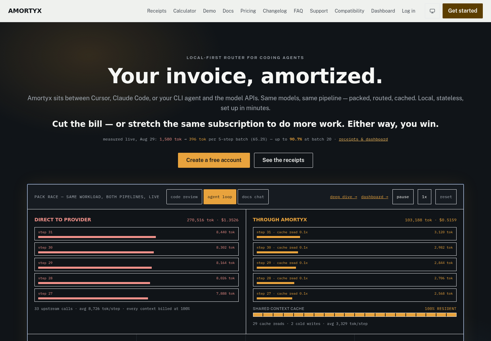
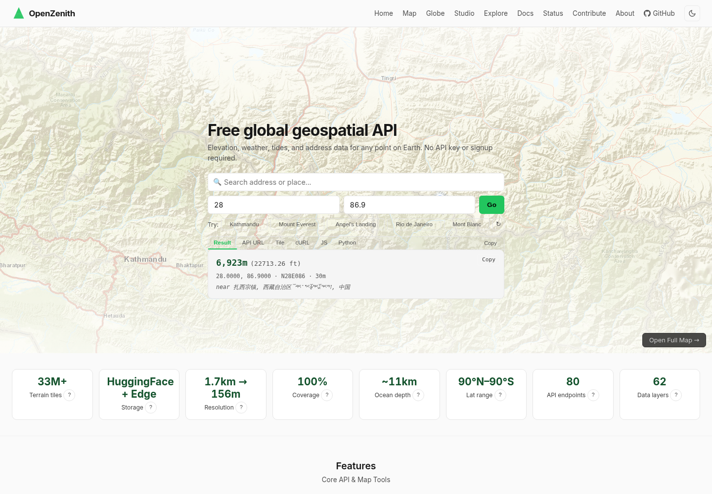
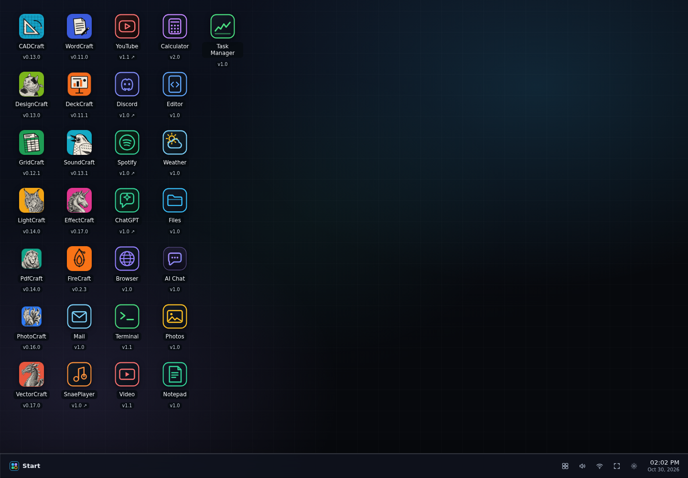
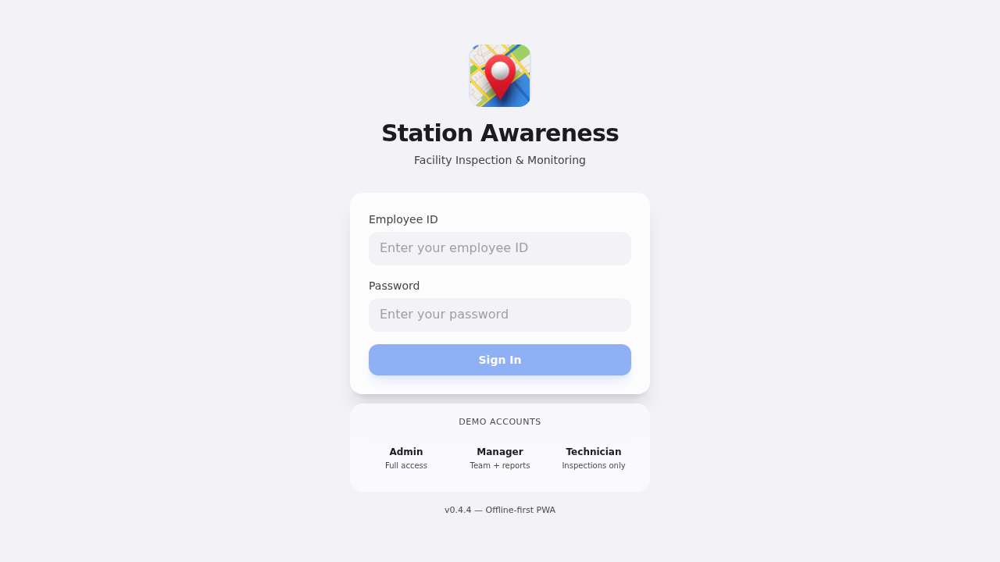
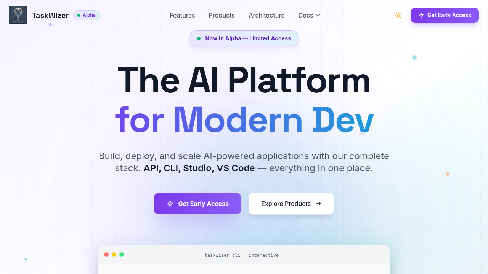
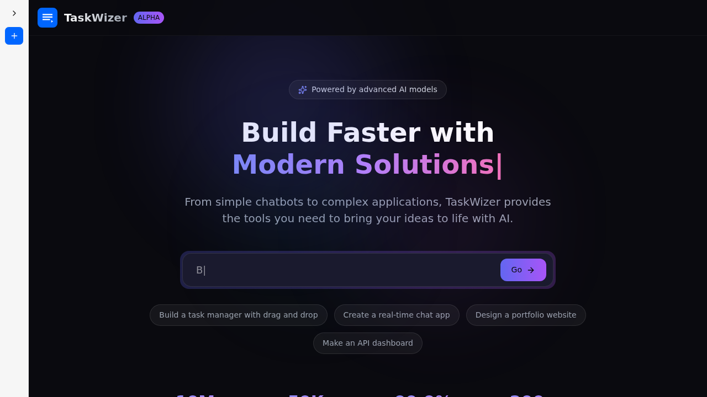
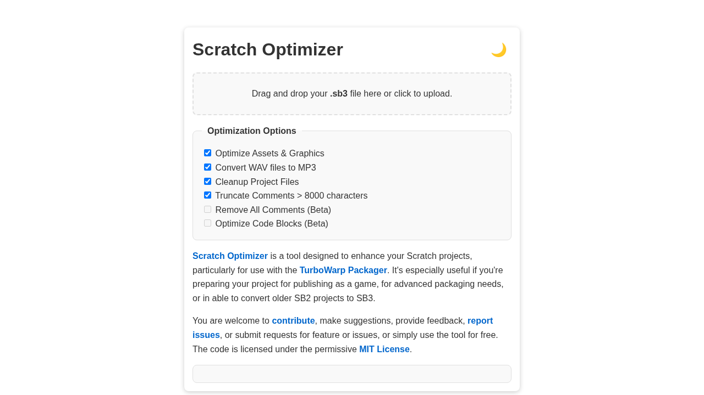
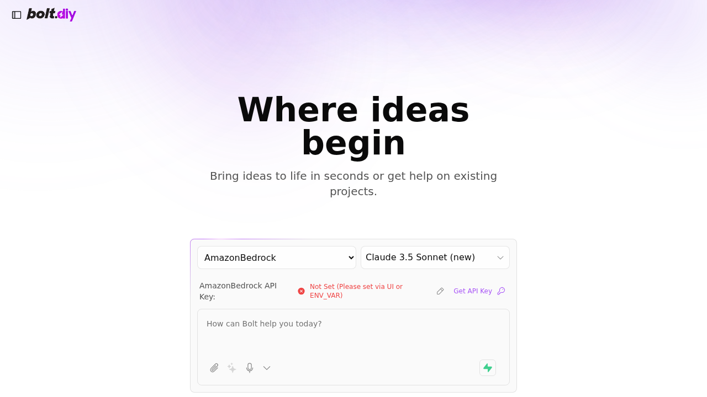
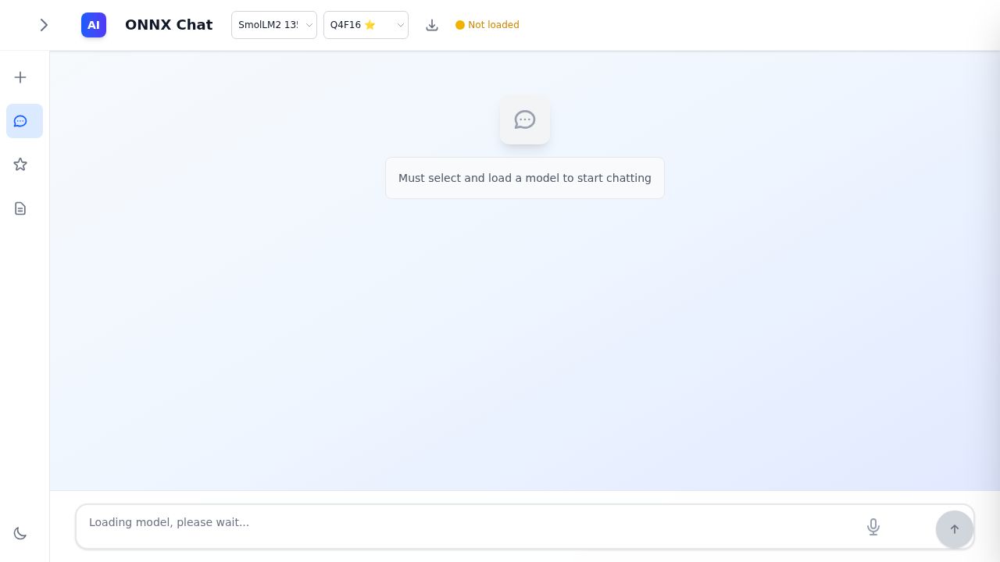

<h1 align="center">AI, software &amp; developer infrastructure</h1>

  Software developer and DevOps engineer exploring practical tools for better
  development workflows, automation, and technical communication.

### Things I code with

  
  
  
  
  
  
  
  
  

## Live projects & demos

<table>
  <tr>
    <td width="33.33%" align="center">
      
       
      <strong><a href="https://www.amortyx.com/">Amortyx</a></strong> 
      Local-first Rust AI router for coding agents.
    </td>
    <td width="33.33%" align="center">
      
       
      <strong><a href="https://openzenith.org/">OpenZenith</a></strong> 
      Global elevation data, geospatial APIs, and map tools.
    </td>
    <td width="33.33%" align="center">
      
       
      <strong><a href="https://artcraft-webos.pages.dev/">ArtCraft WebOS</a></strong> 
      Rough live demo: a browser desktop for creative apps.
    </td>
  </tr>
  <tr>
    <td width="33.33%" align="center">
      
       
      <strong><a href="https://stationawareness.pages.dev/">Station Awareness</a></strong> 
      Offline-first PWA for facility inspections and monitoring.
    </td>
    <td width="33.33%" align="center">
      
       
      <strong><a href="https://taskwizer-landing.pages.dev/">TaskWizer</a></strong> 
      AI platform for building and shipping software.
    </td>
    <td width="33.33%" align="center">
      
       
      <strong><a href="https://studio-taskwizer.pages.dev/">TaskWizer Studio</a></strong> 
      Browser workspace for building AI-powered applications.
    </td>
  </tr>
  <tr>
    <td width="33.33%" align="center">
      
       
      <strong><a href="https://scratch-optimizer.pages.dev/">Scratch Optimizer</a></strong> 
      Clean and optimize Scratch projects before sharing or packaging.
    </td>
    <td width="33.33%" align="center">
      
       
      <strong><a href="https://bolt-main.pages.dev/">Bolt</a></strong> 
      Browser-based AI app prototyping interface; a provider API key is required.
    </td>
    <td width="33.33%" align="center">
      
       
      <strong><a href="https://onnx-chat.pages.dev/">ONNX Chat</a></strong> 
      Browser chat for ONNX models, with tools and notes.
    </td>
  </tr>
</table>

  <a href="https://openportfolio.pages.dev/">Portfolio (work in progress)</a> ·
  <a href="https://aliasfoxkde.github.io/">GitHub Pages site</a> ·
  <a href="https://github.com/aliasfoxkde?tab=repositories">All repositories</a>

## Open-source projects

<table>
  <thead>
    <tr>
      <th>Project</th>
      <th>Focus</th>
      <th>What it does</th>
    </tr>
  </thead>
  <tbody>
    <tr>
      <td><a href="https://github.com/aliasfoxkde/Amortyx">Amortyx</a></td>
      <td>AI infrastructure</td>
      <td>Local-first Rust routing and request optimization for coding agents.</td>
    </tr>
    <tr>
      <td><a href="https://github.com/aliasfoxkde/GitForge">GitForge</a></td>
      <td>Developer infrastructure</td>
      <td>Self-hosted Git and CI/CD with local execution and GitHub synchronization.</td>
    </tr>
    <tr>
      <td><a href="https://github.com/aliasfoxkde/OpenCodifier">OpenCodifier</a></td>
      <td>Code intelligence</td>
      <td>Local, open-source code classification and analysis tools.</td>
    </tr>
    <tr>
      <td><a href="https://github.com/aliasfoxkde/AgentVerify">AgentVerify</a></td>
      <td>Agent reliability</td>
      <td>Checks action-taking agent outcomes and records verification evidence.</td>
    </tr>
    <tr>
      <td><a href="https://github.com/aliasfoxkde/OpenZenith">OpenZenith</a></td>
      <td>Geospatial data</td>
      <td>Open elevation data and geospatial API tools.</td>
    </tr>
    <tr>
      <td><a href="https://github.com/aliasfoxkde/FireCraft">FireCraft</a></td>
      <td>Creative software</td>
      <td>A graphics editor reimplementation built in Rust.</td>
    </tr>
    <tr>
      <td><a href="https://github.com/aliasfoxkde/py7zip">Py7zip</a></td>
      <td>Developer tools</td>
      <td>A cross-platform Python interface to 7-Zip command-line binaries.</td>
    </tr>
  </tbody>
</table>

## Interests

- **AI and machine learning:** agent systems, model routing, local inference,
  and making AI workflows more capable and efficient.
- **Software and infrastructure:** Rust, APIs, developer tools, CI/CD,
  self-hosted services, and local-first systems.
- **Data and connected systems:** geospatial computing, elevation data,
  mapping, and IoT.
- **Creative computing:** design tools and browser-based creative applications.
- **Engineering practice:** process improvement, automation, reproducible
  workflows, and technical writing.
