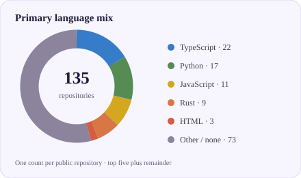

<h1 align="center">AI, software &amp; developer infrastructure</h1>

  Software developer and DevOps engineer exploring practical tools for better
  development workflows, automation, and technical communication.

## GitHub at a glance

  
  <!-- profile-stats:start -->
  
  
  
  
  
  <!-- profile-stats:end -->

  
  

Stats and charts refresh daily from public GitHub data. Language charts count each public repository once by its primary language label; they do not measure code volume, skill, or time spent.

## Highlights

- **AI infrastructure:** [Amortyx](https://github.com/aliasfoxkde/Amortyx) combines request optimization, enforcement, and model routing for AI coding workflows.
- **Fast code intelligence:** [OpenCodifier](https://github.com/aliasfoxkde/OpenCodifier) focuses on local-first classification and analysis.
- **Self-hosted delivery:** [GitForge](https://github.com/aliasfoxkde/GitForge) brings Git hosting and CI/CD closer to the hardware.
- **More experiments:** Browse the [interactive profile demos](https://aliasfoxkde.github.io/examples/) for charts, SVGs, games, and layout ideas.

## Live projects & demos

<table>
  <tr>
    <td width="33.33%" align="center">
      
       
      <strong><a href="https://aliasfoxkde.github.io/examples/projects.html#amortyx">Amortyx</a></strong> 
    </td>
    <td width="33.33%" align="center">
      
       
      <strong><a href="https://aliasfoxkde.github.io/examples/projects.html#openzenith">OpenZenith</a></strong> 
    </td>
    <td width="33.33%" align="center">
      
       
      <strong><a href="https://aliasfoxkde.github.io/examples/projects.html#artcraft-webos">ArtCraft WebOS</a></strong> 
    </td>
  </tr>
  <tr>
    <td width="33.33%" align="center">
      
       
      <strong><a href="https://aliasfoxkde.github.io/examples/projects.html#station-awareness">Station Awareness</a></strong> 
    </td>
    <td width="33.33%" align="center">
      
       
      <strong><a href="https://aliasfoxkde.github.io/examples/projects.html#taskwizer">TaskWizer</a></strong> 
    </td>
    <td width="33.33%" align="center">
      
       
      <strong><a href="https://aliasfoxkde.github.io/examples/projects.html#taskwizer-studio">TaskWizer Studio</a></strong> 
    </td>
  </tr>
  <tr>
    <td width="33.33%" align="center">
      
       
      <strong><a href="https://aliasfoxkde.github.io/examples/projects.html#scratch-optimizer">Scratch Optimizer</a></strong> 
    </td>
    <td width="33.33%" align="center">
      
       
      <strong><a href="https://aliasfoxkde.github.io/examples/projects.html#bolt">Bolt</a></strong> 
    </td>
    <td width="33.33%" align="center">
      
       
      <strong><a href="https://aliasfoxkde.github.io/examples/projects.html#onnx-chat">ONNX Chat</a></strong> 
    </td>
  </tr>
  <tr>
    <td width="33.33%" align="center">
      
       
      <strong><a href="https://aliasfoxkde.github.io/examples/projects.html#prisai">PRISAI</a></strong> 
    </td>
    <td width="33.33%" align="center">
      
       
      <strong><a href="https://aliasfoxkde.github.io/examples/projects.html#siliconrank">SiliconRank</a></strong> 
    </td>
    <td width="33.33%" align="center">
      
       
      <strong><a href="https://aliasfoxkde.github.io/examples/projects.html#opencodifier">OpenCodifier</a></strong> 
    </td>
  </tr>
</table>

  <a href="https://openportfolio.pages.dev/">Portfolio (work in progress)</a> ·
  <a href="https://aliasfoxkde.github.io/">GitHub Pages site</a> ·
  <a href="https://aliasfoxkde.github.io/examples/">Interactive profile widget demos</a> ·
  <a href="https://github.com/aliasfoxkde/aliasfoxkde/tree/main/examples">Cloneable examples source</a> ·
  <a href="https://github.com/aliasfoxkde/aliasfoxkde/blob/main/AGENTS.md">Agent guidance</a> ·
  <a href="https://aliasfoxkde.github.io/examples/projects.html">Flip-card project gallery</a> ·
  <a href="https://github.com/sponsors/aliasfoxkde">Support open-source work</a> ·
  <a href="https://github.com/aliasfoxkde?tab=repositories">All repositories</a>

The profile README source includes a cloneable [`examples/`](./examples/) gallery with local screenshots, interactive profile widgets, reusable SVG templates, and design notes. Clone the repository and follow its [local preview instructions](./examples/README.md); coding agents can use the repository guidance in [`AGENTS.md`](./AGENTS.md).

## Open-source projects

<table>
  <thead>
    <tr>
      <th>Project</th>
      <th>Focus</th>
      <th>What it does</th>
    </tr>
  </thead>
  <tbody>
    <tr>
      <td><a href="https://github.com/aliasfoxkde/Amortyx">Amortyx</a> · <a href="https://github.com/copilot/app/launch?open=ghapp%3A%2F%2Fsession%2Fnew%3Frepo%3Daliasfoxkde%252FAmortyx%26mode%3Dinteractive%26prompt%3DGive%2Bme%2Ba%2Bconcise%2Boverview%2Bof%2Bthis%2Brepository%253A%2Bits%2Bpurpose%252C%2Bkey%2Bcomponents%252C%2Btechnologies%252C%2Band%2Bhow%2Bto%2Bget%2Bstarted.">Ask Copilot</a></td>
      <td>AI infrastructure</td>
      <td>Local-first Rust routing and request optimization for coding agents.</td>
    </tr>
    <tr>
      <td><a href="https://github.com/aliasfoxkde/GitForge">GitForge</a> · <a href="https://github.com/copilot/app/launch?open=ghapp%3A%2F%2Fsession%2Fnew%3Frepo%3Daliasfoxkde%252FGitForge%26mode%3Dinteractive%26prompt%3DGive%2Bme%2Ba%2Bconcise%2Boverview%2Bof%2Bthis%2Brepository%253A%2Bits%2Bpurpose%252C%2Bkey%2Bcomponents%252C%2Btechnologies%252C%2Band%2Bhow%2Bto%2Bget%2Bstarted.">Ask Copilot</a></td>
      <td>Developer infrastructure</td>
      <td>Self-hosted Git and CI/CD with local execution and GitHub synchronization.</td>
    </tr>
    <tr>
      <td><a href="https://github.com/aliasfoxkde/OpenCodifier">OpenCodifier</a> · <a href="https://github.com/copilot/app/launch?open=ghapp%3A%2F%2Fsession%2Fnew%3Frepo%3Daliasfoxkde%252FOpenCodifier%26mode%3Dinteractive%26prompt%3DGive%2Bme%2Ba%2Bconcise%2Boverview%2Bof%2Bthis%2Brepository%253A%2Bits%2Bpurpose%252C%2Bkey%2Bcomponents%252C%2Btechnologies%252C%2Band%2Bhow%2Bto%2Bget%2Bstarted.">Ask Copilot</a></td>
      <td>Code intelligence</td>
      <td>Local, open-source code classification and analysis tools.</td>
    </tr>
    <tr>
      <td><a href="https://github.com/aliasfoxkde/AgentVerify">AgentVerify</a> · <a href="https://github.com/copilot/app/launch?open=ghapp%3A%2F%2Fsession%2Fnew%3Frepo%3Daliasfoxkde%252FAgentVerify%26mode%3Dinteractive%26prompt%3DGive%2Bme%2Ba%2Bconcise%2Boverview%2Bof%2Bthis%2Brepository%253A%2Bits%2Bpurpose%252C%2Bkey%2Bcomponents%252C%2Btechnologies%252C%2Band%2Bhow%2Bto%2Bget%2Bstarted.">Ask Copilot</a></td>
      <td>Agent reliability</td>
      <td>Checks action-taking agent outcomes and records verification evidence.</td>
    </tr>
    <tr>
      <td><a href="https://github.com/aliasfoxkde/OpenZenith">OpenZenith</a> · <a href="https://github.com/copilot/app/launch?open=ghapp%3A%2F%2Fsession%2Fnew%3Frepo%3Daliasfoxkde%252FOpenZenith%26mode%3Dinteractive%26prompt%3DGive%2Bme%2Ba%2Bconcise%2Boverview%2Bof%2Bthis%2Brepository%253A%2Bits%2Bpurpose%252C%2Bkey%2Bcomponents%252C%2Btechnologies%252C%2Band%2Bhow%2Bto%2Bget%2Bstarted.">Ask Copilot</a></td>
      <td>Geospatial data</td>
      <td>Open elevation data and geospatial API tools.</td>
    </tr>
    <tr>
      <td><a href="https://github.com/aliasfoxkde/FireCraft">FireCraft</a> · <a href="https://github.com/copilot/app/launch?open=ghapp%3A%2F%2Fsession%2Fnew%3Frepo%3Daliasfoxkde%252FFireCraft%26mode%3Dinteractive%26prompt%3DGive%2Bme%2Ba%2Bconcise%2Boverview%2Bof%2Bthis%2Brepository%253A%2Bits%2Bpurpose%252C%2Bkey%2Bcomponents%252C%2Btechnologies%252C%2Band%2Bhow%2Bto%2Bget%2Bstarted.">Ask Copilot</a></td>
      <td>Creative software</td>
      <td>A graphics editor reimplementation built in Rust.</td>
    </tr>
    <tr>
      <td><a href="https://github.com/aliasfoxkde/py7zip">Py7zip</a> · <a href="https://github.com/copilot/app/launch?open=ghapp%3A%2F%2Fsession%2Fnew%3Frepo%3Daliasfoxkde%252Fpy7zip%26mode%3Dinteractive%26prompt%3DGive%2Bme%2Ba%2Bconcise%2Boverview%2Bof%2Bthis%2Brepository%253A%2Bits%2Bpurpose%252C%2Bkey%2Bcomponents%252C%2Btechnologies%252C%2Band%2Bhow%2Bto%2Bget%2Bstarted.">Ask Copilot</a></td>
      <td>Developer tools</td>
      <td>A cross-platform Python interface to 7-Zip command-line binaries.</td>
    </tr>
  </tbody>
</table>

## Organizations

  <a href="https://github.com/Cyopsys">Cyopsys</a> ·
  <a href="https://github.com/stackblitz-labs">StackBlitz Labs</a> ·
  <a href="https://github.com/WizerAI">WizerAI</a> ·
  <a href="https://github.com/AI-CRUD-Sandbox">AI-CRUD-Sandbox</a> ·
  <a href="https://github.com/TaskWizer">TaskWizer</a> ·
  <a href="https://github.com/MiniDevPlatform">MiniDevPlatform</a>

## Interests

- **AI and machine learning:** agent systems, model routing, local inference,
  and making AI workflows more capable and efficient.
- **Software and infrastructure:** Rust, APIs, developer tools, CI/CD,
  self-hosted services, and local-first systems.
- **Data and connected systems:** geospatial computing, elevation data,
  mapping, and IoT.
- **Creative computing:** design tools and browser-based creative applications.
- **Engineering practice:** process improvement, automation, reproducible
  workflows, and technical writing.

## Things I code with

  
  
  
  
  
  
  
  
  

## Special thanks

I’m grateful to everyone who supports my open-source work. This list refreshes daily and includes only active sponsorships that sponsors have chosen to make public; private sponsorships and contribution amounts are never shown.

<!-- profile-sponsors:start -->
**0 public sponsors so far.** If you find my open-source work useful, [sponsor me on GitHub](https://github.com/sponsors/aliasfoxkde). Thank you for considering it.
<!-- profile-sponsors:end -->

## Followers

These are public GitHub accounts that follow this profile. The list refreshes daily.

<!-- profile-followers:start -->
<a href="https://github.com/agent7744"><code>@agent7744</code></a>, <a href="https://github.com/anurag-garg01"><code>@anurag-garg01</code></a>, <a href="https://github.com/ask0ldd"><code>@ask0ldd</code></a>, <a href="https://github.com/bludnic"><code>@bludnic</code></a>, <a href="https://github.com/CoreyLeath-code"><code>@CoreyLeath-code</code></a>, <a href="https://github.com/dustinwloring1988"><code>@dustinwloring1988</code></a>, <a href="https://github.com/Dvurechensky"><code>@Dvurechensky</code></a>, <a href="https://github.com/Focus-andmore"><code>@Focus-andmore</code></a>,
<a href="https://github.com/Garhiou"><code>@Garhiou</code></a>, <a href="https://github.com/GoMightyAlgorythmGo"><code>@GoMightyAlgorythmGo</code></a>, <a href="https://github.com/hafiznega4-boo"><code>@hafiznega4-boo</code></a>, <a href="https://github.com/ipqwery"><code>@ipqwery</code></a>, <a href="https://github.com/ishandutta2007"><code>@ishandutta2007</code></a>, <a href="https://github.com/Jawuilp"><code>@Jawuilp</code></a>, <a href="https://github.com/jelspace"><code>@jelspace</code></a>, <a href="https://github.com/JustVugg"><code>@JustVugg</code></a>,
<a href="https://github.com/Kirachon"><code>@Kirachon</code></a>, <a href="https://github.com/kpopdev"><code>@kpopdev</code></a>, <a href="https://github.com/lecanact"><code>@lecanact</code></a>, <a href="https://github.com/lukisch"><code>@lukisch</code></a>, <a href="https://github.com/lvs0"><code>@lvs0</code></a>, <a href="https://github.com/Lxcardoza993"><code>@Lxcardoza993</code></a>, <a href="https://github.com/mbelalhossain718-cpu"><code>@mbelalhossain718-cpu</code></a>, <a href="https://github.com/micasa96"><code>@micasa96</code></a>,
<a href="https://github.com/Murplugg"><code>@Murplugg</code></a>, <a href="https://github.com/OriNachum"><code>@OriNachum</code></a>, <a href="https://github.com/peytondsay"><code>@peytondsay</code></a>, <a href="https://github.com/poormikey80-create"><code>@poormikey80-create</code></a>, <a href="https://github.com/pwnedroot"><code>@pwnedroot</code></a>, <a href="https://github.com/RaduNG"><code>@RaduNG</code></a>, <a href="https://github.com/RemoteBrowser01"><code>@RemoteBrowser01</code></a>, <a href="https://github.com/ssoad"><code>@ssoad</code></a>,
<a href="https://github.com/standardgalactic"><code>@standardgalactic</code></a>, <a href="https://github.com/takumi-sato0209"><code>@takumi-sato0209</code></a>, <a href="https://github.com/tysoncung"><code>@tysoncung</code></a>, <a href="https://github.com/UtkarshSaini2006"><code>@UtkarshSaini2006</code></a>, <a href="https://github.com/vatsalnaresh555"><code>@vatsalnaresh555</code></a>, <a href="https://github.com/vinodkumar99000"><code>@vinodkumar99000</code></a>, <a href="https://github.com/xiscoding"><code>@xiscoding</code></a>, <a href="https://github.com/zyadhajaji"><code>@zyadhajaji</code></a>
<!-- profile-followers:end -->
