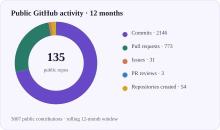
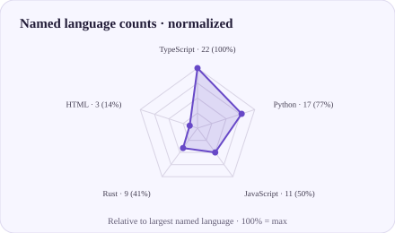
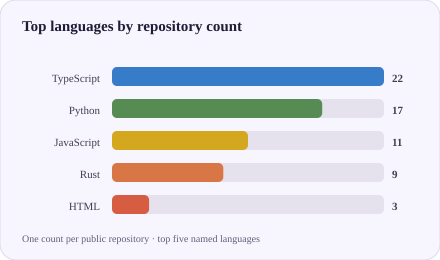
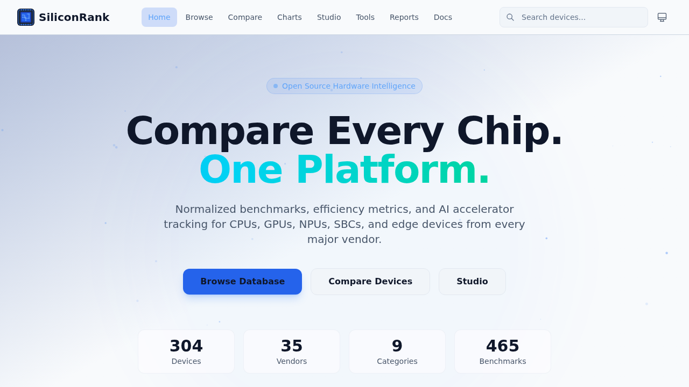
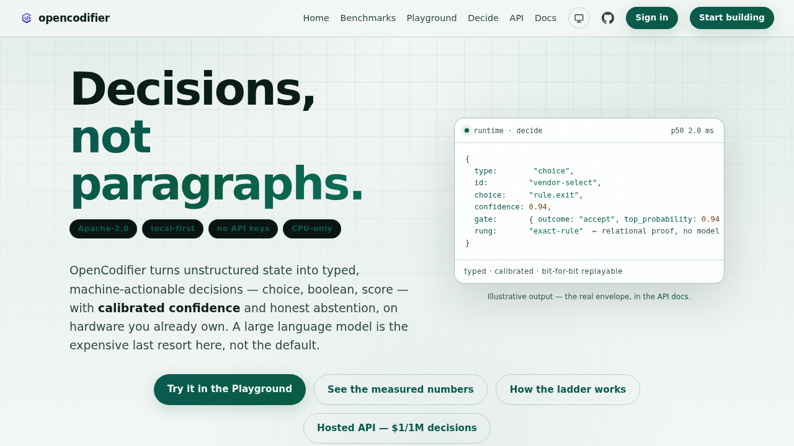

<h1 align="center">AI, software &amp; developer infrastructure</h1>

  Software developer and DevOps engineer exploring practical tools for better
  development workflows, automation, and technical communication.

## GitHub at a glance

  
  <!-- profile-stats:start -->
  
  
  
  
  
  <!-- profile-stats:end -->

  
  
  

Stats and charts refresh daily from public GitHub data. The donut shows public contributions over the last 12 months and the current public repository total; the radar and bars count each public repository once by primary language, not code volume, skill, or time spent.

## Highlights

- **AI infrastructure:** [Amortyx](https://github.com/aliasfoxkde/Amortyx) combines request optimization, enforcement, and model routing for AI coding workflows.
- **Fast code intelligence:** [OpenCodifier](https://github.com/aliasfoxkde/OpenCodifier) focuses on local-first classification and analysis.
- **Self-hosted delivery:** [GitForge](https://github.com/aliasfoxkde/GitForge) brings Git hosting and CI/CD closer to the hardware.
- **More experiments:** Browse the [interactive profile demos](https://aliasfoxkde.github.io/examples/) for charts, SVGs, games, and layout ideas.

## Live projects & demos

<table>
  <tr>
    <td width="33.33%" align="center">
      
       
      <strong><a href="https://amortyx.com/">Amortyx</a></strong> 
      AI request optimization, enforcement, and model routing.
    </td>
    <td width="33.33%" align="center">
      
       
      <strong><a href="https://openzenith.org/">OpenZenith</a></strong> 
      Open elevation data, geospatial APIs, and mapping tools.
    </td>
    <td width="33.33%" align="center">
      
       
      <strong><a href="https://artcraft-webos.pages.dev/">ArtCraft WebOS</a></strong> 
      A browser desktop concept for creative applications.
    </td>
  </tr>
  <tr>
    <td width="33.33%" align="center">
      
       
      <strong><a href="https://stationawareness.pages.dev/">Station Awareness</a></strong> 
      Offline-first facility inspection and monitoring.
    </td>
    <td width="33.33%" align="center">
      
       
      <strong><a href="https://taskwizer-landing.pages.dev/">TaskWizer</a></strong> 
      An AI development platform for planning and shipping software.
    </td>
    <td width="33.33%" align="center">
      
       
      <strong><a href="https://studio-taskwizer.pages.dev/">TaskWizer Studio</a></strong> 
      A browser workspace for AI-powered applications and workflows.
    </td>
  </tr>
  <tr>
    <td width="33.33%" align="center">
      
       
      <strong><a href="https://scratch-optimizer.pages.dev/">Scratch Optimizer</a></strong> 
      Clean and optimize Scratch projects before sharing.
    </td>
    <td width="33.33%" align="center">
      
       
      <strong><a href="https://bolt-main.pages.dev/">Bolt</a></strong> 
      Browser-based AI app prototyping; a provider API key is required.
    </td>
    <td width="33.33%" align="center">
      
       
      <strong><a href="https://onnx-chat.pages.dev/">ONNX Chat</a></strong> 
      Browser chat for ONNX models with tools and notes.
    </td>
  </tr>
  <tr>
    <td width="33.33%" align="center">
      
       
      <strong><a href="https://prisai-cha.pages.dev/">PRISAI</a></strong> 
      Property-records intelligence system; public demo sign-in required.
    </td>
    <td width="33.33%" align="center">
      
       
      <strong><a href="https://siliconrank.pages.dev/">SiliconRank</a></strong> 
      Compare CPUs, GPUs, and AI accelerators with open hardware data.
    </td>
    <td width="33.33%" align="center">
      
       
      <strong><a href="https://opencodifier.pages.dev/">OpenCodifier</a></strong> 
      Fast, local-first code intelligence and decision tooling.
    </td>
  </tr>
</table>

  <a href="https://openportfolio.pages.dev/">Portfolio (work in progress)</a> ·
  <a href="https://aliasfoxkde.github.io/">GitHub Pages site</a> ·
  <a href="https://aliasfoxkde.github.io/examples/">Interactive profile widget demos</a> ·
  <a href="https://github.com/aliasfoxkde/aliasfoxkde/tree/main/examples">Cloneable examples source</a> ·
  <a href="https://github.com/aliasfoxkde/aliasfoxkde/blob/main/AGENTS.md">Agent guidance</a> ·
  <a href="https://aliasfoxkde.github.io/examples/projects.html">Project gallery demo</a> ·
  <a href="https://github.com/sponsors/aliasfoxkde">Support open-source work</a> ·
  <a href="https://github.com/aliasfoxkde?tab=repositories">All repositories</a>

The profile README source includes a cloneable [`examples/`](./examples/) gallery with local screenshots, interactive profile widgets, reusable SVG templates, and design notes. Clone the repository and follow its [local preview instructions](./examples/README.md); coding agents can use the repository guidance in [`AGENTS.md`](./AGENTS.md).

## Open-source projects

<!-- profile-projects:start -->

  
Show all 33 public project repositories

Refreshed daily from public GitHub data. Lists original repositories (not forks), including archived projects; licensing and maintenance status are defined per repository.

<table>
  <thead><tr><th>Project</th><th>Primary language</th><th>Status</th><th>About</th></tr></thead>
  <tbody>
    <tr><td><a href="https://github.com/aliasfoxkde/aegis">aegis</a> · <a href="https://github.com/copilot/app/launch?open=ghapp%3A%2F%2Fsession%2Fnew%3Frepo%3Daliasfoxkde%252Faegis%26mode%3Dinteractive%26prompt%3DGive%2520me%2520a%2520concise%2520overview%2520of%2520this%2520repository%253A%2520its%2520purpose%252C%2520key%2520components%252C%2520technologies%252C%2520and%2520how%2520to%2520get%2520started.">Ask Copilot</a></td><td>Rust</td><td>Active</td><td>Aegis - High-performance security scanning tool for DevOps, CI/CD, and AI systems. 670 detection patterns for secrets, credentials, vulnerabilities, and AI-generated code.</td></tr>
    <tr><td><a href="https://github.com/aliasfoxkde/AgentVerify">AgentVerify</a> · <a href="https://github.com/copilot/app/launch?open=ghapp%3A%2F%2Fsession%2Fnew%3Frepo%3Daliasfoxkde%252FAgentVerify%26mode%3Dinteractive%26prompt%3DGive%2520me%2520a%2520concise%2520overview%2520of%2520this%2520repository%253A%2520its%2520purpose%252C%2520key%2520components%252C%2520technologies%252C%2520and%2520how%2520to%2520get%2520started.">Ask Copilot</a></td><td>Rust</td><td>Active</td><td>AgentVerify is an open source outcome verification for action-taking AI agents. It checks that high-risk actions reached the required final state in your systems of record and preserves the evidence in signed receipts.</td></tr>
    <tr><td><a href="https://github.com/aliasfoxkde/AI-SVG-Creator">AI-SVG-Creator</a> · <a href="https://github.com/copilot/app/launch?open=ghapp%3A%2F%2Fsession%2Fnew%3Frepo%3Daliasfoxkde%252FAI-SVG-Creator%26mode%3Dinteractive%26prompt%3DGive%2520me%2520a%2520concise%2520overview%2520of%2520this%2520repository%253A%2520its%2520purpose%252C%2520key%2520components%252C%2520technologies%252C%2520and%2520how%2520to%2520get%2520started.">Ask Copilot</a></td><td>Python</td><td>Active</td><td>While beyond the initial scope of this SVG generation tool, it could be very useful (think MCP, etc.) to create animations, video/short, game assets, reading book, or play-through storyline, and more.</td></tr>
    <tr><td><a href="https://github.com/aliasfoxkde/aliasfoxkde">aliasfoxkde</a> · <a href="https://github.com/copilot/app/launch?open=ghapp%3A%2F%2Fsession%2Fnew%3Frepo%3Daliasfoxkde%252Faliasfoxkde%26mode%3Dinteractive%26prompt%3DGive%2520me%2520a%2520concise%2520overview%2520of%2520this%2520repository%253A%2520its%2520purpose%252C%2520key%2520components%252C%2520technologies%252C%2520and%2520how%2520to%2520get%2520started.">Ask Copilot</a></td><td>Python</td><td>Active</td><td>GitHub profile README for Aliasfoxkde.</td></tr>
    <tr><td><a href="https://github.com/aliasfoxkde/aliasfoxkde.github.io">aliasfoxkde.github.io</a> · <a href="https://github.com/copilot/app/launch?open=ghapp%3A%2F%2Fsession%2Fnew%3Frepo%3Daliasfoxkde%252Faliasfoxkde.github.io%26mode%3Dinteractive%26prompt%3DGive%2520me%2520a%2520concise%2520overview%2520of%2520this%2520repository%253A%2520its%2520purpose%252C%2520key%2520components%252C%2520technologies%252C%2520and%2520how%2520to%2520get%2520started.">Ask Copilot</a></td><td>HTML</td><td>Active</td><td>No description provided.</td></tr>
    <tr><td><a href="https://github.com/aliasfoxkde/Atheon-Benchmark">Atheon-Benchmark</a> · <a href="https://github.com/copilot/app/launch?open=ghapp%3A%2F%2Fsession%2Fnew%3Frepo%3Daliasfoxkde%252FAtheon-Benchmark%26mode%3Dinteractive%26prompt%3DGive%2520me%2520a%2520concise%2520overview%2520of%2520this%2520repository%253A%2520its%2520purpose%252C%2520key%2520components%252C%2520technologies%252C%2520and%2520how%2520to%2520get%2520started.">Ask Copilot</a></td><td>TypeScript</td><td>Archived</td><td>Standardized benchmark system for Atheon pattern matching engine performance and quality testing</td></tr>
    <tr><td><a href="https://github.com/aliasfoxkde/Atheon-Scanner">Atheon-Scanner</a> · <a href="https://github.com/copilot/app/launch?open=ghapp%3A%2F%2Fsession%2Fnew%3Frepo%3Daliasfoxkde%252FAtheon-Scanner%26mode%3Dinteractive%26prompt%3DGive%2520me%2520a%2520concise%2520overview%2520of%2520this%2520repository%253A%2520its%2520purpose%252C%2520key%2520components%252C%2520technologies%252C%2520and%2520how%2520to%2520get%2520started.">Ask Copilot</a></td><td>HTML</td><td>Archived</td><td>Automated GitHub repository scanning and quality analysis system using Atheon patterns</td></tr>
    <tr><td><a href="https://github.com/aliasfoxkde/back4app_vscode_integration">back4app_vscode_integration</a> · <a href="https://github.com/copilot/app/launch?open=ghapp%3A%2F%2Fsession%2Fnew%3Frepo%3Daliasfoxkde%252Fback4app_vscode_integration%26mode%3Dinteractive%26prompt%3DGive%2520me%2520a%2520concise%2520overview%2520of%2520this%2520repository%253A%2520its%2520purpose%252C%2520key%2520components%252C%2520technologies%252C%2520and%2520how%2520to%2520get%2520started.">Ask Copilot</a></td><td>TypeScript</td><td>Active</td><td>VScode Extension for back4app integration.</td></tr>
    <tr><td><a href="https://github.com/aliasfoxkde/blender-wasm">blender-wasm</a> · <a href="https://github.com/copilot/app/launch?open=ghapp%3A%2F%2Fsession%2Fnew%3Frepo%3Daliasfoxkde%252Fblender-wasm%26mode%3Dinteractive%26prompt%3DGive%2520me%2520a%2520concise%2520overview%2520of%2520this%2520repository%253A%2520its%2520purpose%252C%2520key%2520components%252C%2520technologies%252C%2520and%2520how%2520to%2520get%2520started.">Ask Copilot</a></td><td>TypeScript</td><td>Active</td><td>Blender optimized and compiled to run in the browser.</td></tr>
    <tr><td><a href="https://github.com/aliasfoxkde/bolt-terminal">bolt-terminal</a> · <a href="https://github.com/copilot/app/launch?open=ghapp%3A%2F%2Fsession%2Fnew%3Frepo%3Daliasfoxkde%252Fbolt-terminal%26mode%3Dinteractive%26prompt%3DGive%2520me%2520a%2520concise%2520overview%2520of%2520this%2520repository%253A%2520its%2520purpose%252C%2520key%2520components%252C%2520technologies%252C%2520and%2520how%2520to%2520get%2520started.">Ask Copilot</a></td><td>JavaScript</td><td>Active</td><td>No description provided.</td></tr>
    <tr><td><a href="https://github.com/aliasfoxkde/Buy_A_Buddy">Buy_A_Buddy</a> · <a href="https://github.com/copilot/app/launch?open=ghapp%3A%2F%2Fsession%2Fnew%3Frepo%3Daliasfoxkde%252FBuy_A_Buddy%26mode%3Dinteractive%26prompt%3DGive%2520me%2520a%2520concise%2520overview%2520of%2520this%2520repository%253A%2520its%2520purpose%252C%2520key%2520components%252C%2520technologies%252C%2520and%2520how%2520to%2520get%2520started.">Ask Copilot</a></td><td>TypeScript</td><td>Active</td><td>An adventure game created by Fabel, created by AI.</td></tr>
    <tr><td><a href="https://github.com/aliasfoxkde/cinematic-template-composer">cinematic-template-composer</a> · <a href="https://github.com/copilot/app/launch?open=ghapp%3A%2F%2Fsession%2Fnew%3Frepo%3Daliasfoxkde%252Fcinematic-template-composer%26mode%3Dinteractive%26prompt%3DGive%2520me%2520a%2520concise%2520overview%2520of%2520this%2520repository%253A%2520its%2520purpose%252C%2520key%2520components%252C%2520technologies%252C%2520and%2520how%2520to%2520get%2520started.">Ask Copilot</a></td><td>TypeScript</td><td>Active</td><td>Cinematic Template Composer to generate tailored AI prompts.</td></tr>
    <tr><td><a href="https://github.com/aliasfoxkde/Codewars">Codewars</a> · <a href="https://github.com/copilot/app/launch?open=ghapp%3A%2F%2Fsession%2Fnew%3Frepo%3Daliasfoxkde%252FCodewars%26mode%3Dinteractive%26prompt%3DGive%2520me%2520a%2520concise%2520overview%2520of%2520this%2520repository%253A%2520its%2520purpose%252C%2520key%2520components%252C%2520technologies%252C%2520and%2520how%2520to%2520get%2520started.">Ask Copilot</a></td><td>—</td><td>Active</td><td>Simply documenting of my CodeWars solutions.</td></tr>
    <tr><td><a href="https://github.com/aliasfoxkde/dark-factory">dark-factory</a> · <a href="https://github.com/copilot/app/launch?open=ghapp%3A%2F%2Fsession%2Fnew%3Frepo%3Daliasfoxkde%252Fdark-factory%26mode%3Dinteractive%26prompt%3DGive%2520me%2520a%2520concise%2520overview%2520of%2520this%2520repository%253A%2520its%2520purpose%252C%2520key%2520components%252C%2520technologies%252C%2520and%2520how%2520to%2520get%2520started.">Ask Copilot</a></td><td>Makefile</td><td>Active</td><td>Dark Factory: AI-first template repo with CI/CD, pre-commit hooks, E2E testing framework, and reusable code library. Designed for 90%+ automated coverage.</td></tr>
    <tr><td><a href="https://github.com/aliasfoxkde/DevOpsRPG">DevOpsRPG</a> · <a href="https://github.com/copilot/app/launch?open=ghapp%3A%2F%2Fsession%2Fnew%3Frepo%3Daliasfoxkde%252FDevOpsRPG%26mode%3Dinteractive%26prompt%3DGive%2520me%2520a%2520concise%2520overview%2520of%2520this%2520repository%253A%2520its%2520purpose%252C%2520key%2520components%252C%2520technologies%252C%2520and%2520how%2520to%2520get%2520started.">Ask Copilot</a></td><td>TypeScript</td><td>Active</td><td>Attempt at creating an open-source BootDotDev interactive Software Development experience.</td></tr>
    <tr><td><a href="https://github.com/aliasfoxkde/FireCraft">FireCraft</a> · <a href="https://github.com/copilot/app/launch?open=ghapp%3A%2F%2Fsession%2Fnew%3Frepo%3Daliasfoxkde%252FFireCraft%26mode%3Dinteractive%26prompt%3DGive%2520me%2520a%2520concise%2520overview%2520of%2520this%2520repository%253A%2520its%2520purpose%252C%2520key%2520components%252C%2520technologies%252C%2520and%2520how%2520to%2520get%2520started.">Ask Copilot</a></td><td>Rust</td><td>Active</td><td>An open-source, clean-room reimplementation of Adobe Fireworks in pure Rust based on work done by StoryTold.</td></tr>
    <tr><td><a href="https://github.com/aliasfoxkde/GitForge">GitForge</a> · <a href="https://github.com/copilot/app/launch?open=ghapp%3A%2F%2Fsession%2Fnew%3Frepo%3Daliasfoxkde%252FGitForge%26mode%3Dinteractive%26prompt%3DGive%2520me%2520a%2520concise%2520overview%2520of%2520this%2520repository%253A%2520its%2520purpose%252C%2520key%2520components%252C%2520technologies%252C%2520and%2520how%2520to%2520get%2520started.">Ask Copilot</a></td><td>Rust</td><td>Active</td><td>GitForge is a self-hosted, fast and efficient, GitHub backend replacement for CI/CD, Actions, efficient compute, written in Rust. The idea is to run all actions locally, getting all GitHub paid features for free as well as performance enhancements, speedup, and so on, all while syncing to GitHub for sharing, static backup, and normal operations.</td></tr>
    <tr><td><a href="https://github.com/aliasfoxkde/hermes-workspace-deploy">hermes-workspace-deploy</a> · <a href="https://github.com/copilot/app/launch?open=ghapp%3A%2F%2Fsession%2Fnew%3Frepo%3Daliasfoxkde%252Fhermes-workspace-deploy%26mode%3Dinteractive%26prompt%3DGive%2520me%2520a%2520concise%2520overview%2520of%2520this%2520repository%253A%2520its%2520purpose%252C%2520key%2520components%252C%2520technologies%252C%2520and%2520how%2520to%2520get%2520started.">Ask Copilot</a></td><td>Shell</td><td>Active</td><td>Hermes Workspace deployment configs: Caddy reverse proxy, Cloudflare Tunnel, systemd units</td></tr>
    <tr><td><a href="https://github.com/aliasfoxkde/kona">kona</a> · <a href="https://github.com/copilot/app/launch?open=ghapp%3A%2F%2Fsession%2Fnew%3Frepo%3Daliasfoxkde%252Fkona%26mode%3Dinteractive%26prompt%3DGive%2520me%2520a%2520concise%2520overview%2520of%2520this%2520repository%253A%2520its%2520purpose%252C%2520key%2520components%252C%2520technologies%252C%2520and%2520how%2520to%2520get%2520started.">Ask Copilot</a></td><td>JavaScript</td><td>Active</td><td>No description provided.</td></tr>
    <tr><td><a href="https://github.com/aliasfoxkde/min3js">min3js</a> · <a href="https://github.com/copilot/app/launch?open=ghapp%3A%2F%2Fsession%2Fnew%3Frepo%3Daliasfoxkde%252Fmin3js%26mode%3Dinteractive%26prompt%3DGive%2520me%2520a%2520concise%2520overview%2520of%2520this%2520repository%253A%2520its%2520purpose%252C%2520key%2520components%252C%2520technologies%252C%2520and%2520how%2520to%2520get%2520started.">Ask Copilot</a></td><td>JavaScript</td><td>Active</td><td>No description provided.</td></tr>
    <tr><td><a href="https://github.com/aliasfoxkde/minecraft">minecraft</a> · <a href="https://github.com/copilot/app/launch?open=ghapp%3A%2F%2Fsession%2Fnew%3Frepo%3Daliasfoxkde%252Fminecraft%26mode%3Dinteractive%26prompt%3DGive%2520me%2520a%2520concise%2520overview%2520of%2520this%2520repository%253A%2520its%2520purpose%252C%2520key%2520components%252C%2520technologies%252C%2520and%2520how%2520to%2520get%2520started.">Ask Copilot</a></td><td>HTML</td><td>Active</td><td>No description provided.</td></tr>
    <tr><td><a href="https://github.com/aliasfoxkde/OpenCAD">OpenCAD</a> · <a href="https://github.com/copilot/app/launch?open=ghapp%3A%2F%2Fsession%2Fnew%3Frepo%3Daliasfoxkde%252FOpenCAD%26mode%3Dinteractive%26prompt%3DGive%2520me%2520a%2520concise%2520overview%2520of%2520this%2520repository%253A%2520its%2520purpose%252C%2520key%2520components%252C%2520technologies%252C%2520and%2520how%2520to%2520get%2520started.">Ask Copilot</a></td><td>TypeScript</td><td>Active</td><td>An attempt to build a distributed geometry and parametric modeling platform for use in CAD, CAM, CAE, Electronics and 3D Printing, leveraging AI.</td></tr>
    <tr><td><a href="https://github.com/aliasfoxkde/OpenCodifier">OpenCodifier</a> · <a href="https://github.com/copilot/app/launch?open=ghapp%3A%2F%2Fsession%2Fnew%3Frepo%3Daliasfoxkde%252FOpenCodifier%26mode%3Dinteractive%26prompt%3DGive%2520me%2520a%2520concise%2520overview%2520of%2520this%2520repository%253A%2520its%2520purpose%252C%2520key%2520components%252C%2520technologies%252C%2520and%2520how%2520to%2520get%2520started.">Ask Copilot</a></td><td>Rust</td><td>Active</td><td>OpenCodifier operates similarly to JEV classification, with drop-in schema support, but completely free, Open-Source, optimized for local, and private use.</td></tr>
    <tr><td><a href="https://github.com/aliasfoxkde/OpenPortfolio">OpenPortfolio</a> · <a href="https://github.com/copilot/app/launch?open=ghapp%3A%2F%2Fsession%2Fnew%3Frepo%3Daliasfoxkde%252FOpenPortfolio%26mode%3Dinteractive%26prompt%3DGive%2520me%2520a%2520concise%2520overview%2520of%2520this%2520repository%253A%2520its%2520purpose%252C%2520key%2520components%252C%2520technologies%252C%2520and%2520how%2520to%2520get%2520started.">Ask Copilot</a></td><td>TypeScript</td><td>Active</td><td>A simple unified portfolio platform for building modern portfolios, consolidating, and unifying all projects into a single place.</td></tr>
    <tr><td><a href="https://github.com/aliasfoxkde/OpenPress">OpenPress</a> · <a href="https://github.com/copilot/app/launch?open=ghapp%3A%2F%2Fsession%2Fnew%3Frepo%3Daliasfoxkde%252FOpenPress%26mode%3Dinteractive%26prompt%3DGive%2520me%2520a%2520concise%2520overview%2520of%2520this%2520repository%253A%2520its%2520purpose%252C%2520key%2520components%252C%2520technologies%252C%2520and%2520how%2520to%2520get%2520started.">Ask Copilot</a></td><td>TypeScript</td><td>Active</td><td>A re-imaging and rebuild of WordPress for the modern web—CSR-first, edge-native, JS-first, Cloudflare-native, and designed to become a drop-in replacement, and future AI platform.</td></tr>
    <tr><td><a href="https://github.com/aliasfoxkde/OpenZenith">OpenZenith</a> · <a href="https://github.com/copilot/app/launch?open=ghapp%3A%2F%2Fsession%2Fnew%3Frepo%3Daliasfoxkde%252FOpenZenith%26mode%3Dinteractive%26prompt%3DGive%2520me%2520a%2520concise%2520overview%2520of%2520this%2520repository%253A%2520its%2520purpose%252C%2520key%2520components%252C%2520technologies%252C%2520and%2520how%2520to%2520get%2520started.">Ask Copilot</a></td><td>TypeScript</td><td>Active</td><td>Elevation data that offers Efficiency, Simplicity, Coverage, Accuracy, and Size.</td></tr>
    <tr><td><a href="https://github.com/aliasfoxkde/py7zip">py7zip</a> · <a href="https://github.com/copilot/app/launch?open=ghapp%3A%2F%2Fsession%2Fnew%3Frepo%3Daliasfoxkde%252Fpy7zip%26mode%3Dinteractive%26prompt%3DGive%2520me%2520a%2520concise%2520overview%2520of%2520this%2520repository%253A%2520its%2520purpose%252C%2520key%2520components%252C%2520technologies%252C%2520and%2520how%2520to%2520get%2520started.">Ask Copilot</a></td><td>Python</td><td>Active</td><td>An unofficial, cross platform, lightweight and easy to use port of 7zip command line binaries (7za) for Python. Unlike other libraries, this one fully supports 7zip natively, is easy to setup/install, and is &quot;pythonic&quot; with the intent to be used in code and scripts, not through the terminal.</td></tr>
    <tr><td><a href="https://github.com/aliasfoxkde/RandomChallenges">RandomChallenges</a> · <a href="https://github.com/copilot/app/launch?open=ghapp%3A%2F%2Fsession%2Fnew%3Frepo%3Daliasfoxkde%252FRandomChallenges%26mode%3Dinteractive%26prompt%3DGive%2520me%2520a%2520concise%2520overview%2520of%2520this%2520repository%253A%2520its%2520purpose%252C%2520key%2520components%252C%2520technologies%252C%2520and%2520how%2520to%2520get%2520started.">Ask Copilot</a></td><td>Python</td><td>Active</td><td>Random Python scripts built as I come across interesting challenges or brain teasers.</td></tr>
    <tr><td><a href="https://github.com/aliasfoxkde/scratch-optimizer">scratch-optimizer</a> · <a href="https://github.com/copilot/app/launch?open=ghapp%3A%2F%2Fsession%2Fnew%3Frepo%3Daliasfoxkde%252Fscratch-optimizer%26mode%3Dinteractive%26prompt%3DGive%2520me%2520a%2520concise%2520overview%2520of%2520this%2520repository%253A%2520its%2520purpose%252C%2520key%2520components%252C%2520technologies%252C%2520and%2520how%2520to%2520get%2520started.">Ask Copilot</a></td><td>JavaScript</td><td>Active</td><td>SB3 Optimizer Webapp for Scratch.</td></tr>
    <tr><td><a href="https://github.com/aliasfoxkde/SiliconRank">SiliconRank</a> · <a href="https://github.com/copilot/app/launch?open=ghapp%3A%2F%2Fsession%2Fnew%3Frepo%3Daliasfoxkde%252FSiliconRank%26mode%3Dinteractive%26prompt%3DGive%2520me%2520a%2520concise%2520overview%2520of%2520this%2520repository%253A%2520its%2520purpose%252C%2520key%2520components%252C%2520technologies%252C%2520and%2520how%2520to%2520get%2520started.">Ask Copilot</a></td><td>TypeScript</td><td>Active</td><td>An attempt at normalizing compute/hardware into a unified hup to compare data at scale, including but not limited to AI Accelerators, All-in-one solutions, ASICs, CPUs, Hard Drives, GPUs, RAM, SBCs, Systems, TPUs, and etcetera.</td></tr>
    <tr><td><a href="https://github.com/aliasfoxkde/snippets">snippets</a> · <a href="https://github.com/copilot/app/launch?open=ghapp%3A%2F%2Fsession%2Fnew%3Frepo%3Daliasfoxkde%252Fsnippets%26mode%3Dinteractive%26prompt%3DGive%2520me%2520a%2520concise%2520overview%2520of%2520this%2520repository%253A%2520its%2520purpose%252C%2520key%2520components%252C%2520technologies%252C%2520and%2520how%2520to%2520get%2520started.">Ask Copilot</a></td><td>Python</td><td>Active</td><td>Python Code Snippets Created while learning</td></tr>
    <tr><td><a href="https://github.com/aliasfoxkde/template">template</a> · <a href="https://github.com/copilot/app/launch?open=ghapp%3A%2F%2Fsession%2Fnew%3Frepo%3Daliasfoxkde%252Ftemplate%26mode%3Dinteractive%26prompt%3DGive%2520me%2520a%2520concise%2520overview%2520of%2520this%2520repository%253A%2520its%2520purpose%252C%2520key%2520components%252C%2520technologies%252C%2520and%2520how%2520to%2520get%2520started.">Ask Copilot</a></td><td>Python</td><td>Active</td><td>A &quot;Template&quot; repository containing the tools and scripts I use on a regular basis for other repositories, so that the files can be updated and maintained in one place and an &quot;update&quot; script can keep the others up-to-date. Additionally, this &quot;Template&quot; contains the starter files and structure for a standard project. So basically, this is a repository designed to save overall development time (maybe not a lot but it adds up).</td></tr>
    <tr><td><a href="https://github.com/aliasfoxkde/webos-deploy">webos-deploy</a> · <a href="https://github.com/copilot/app/launch?open=ghapp%3A%2F%2Fsession%2Fnew%3Frepo%3Daliasfoxkde%252Fwebos-deploy%26mode%3Dinteractive%26prompt%3DGive%2520me%2520a%2520concise%2520overview%2520of%2520this%2520repository%253A%2520its%2520purpose%252C%2520key%2520components%252C%2520technologies%252C%2520and%2520how%2520to%2520get%2520started.">Ask Copilot</a></td><td>JavaScript</td><td>Active</td><td>ArtCraft WebOS — a browser desktop for the ArtCraft craft apps: plugin apps, App Store, widget sidebar. CSR-only; builds sync from upstream releases.</td></tr>
  </tbody>
</table>

<!-- profile-projects:end -->

## Organizations

  <a href="https://github.com/Cyopsys">Cyopsys</a> ·
  <a href="https://github.com/stackblitz-labs">StackBlitz Labs</a> ·
  <a href="https://github.com/WizerAI">WizerAI</a> ·
  <a href="https://github.com/AI-CRUD-Sandbox">AI-CRUD-Sandbox</a> ·
  <a href="https://github.com/TaskWizer">TaskWizer</a> ·
  <a href="https://github.com/MiniDevPlatform">MiniDevPlatform</a>

## Interests

- **AI and machine learning:** agent systems, model routing, local inference,
  and making AI workflows more capable and efficient.
- **Software, DevOps, and infrastructure:** Rust, APIs, developer tools,
  CI/CD, deployment automation, self-hosted services, and local-first systems.
- **Data and connected systems:** geospatial computing, elevation data,
  mapping, IoT, and connected-device workflows.
- **Art and creative computing:** traditional and digital art, drawing,
  design, and browser-based creative applications.
- **Engineering practice:** process improvement, automation, reproducible
  workflows, and technical writing.

## Things I code with

  
  
  
  
  
  
  
  
  

## Special thanks

I’m grateful to everyone who supports my open-source work. This list refreshes daily and includes only active sponsorships that sponsors have chosen to make public; private sponsorships and contribution amounts are never shown.

<!-- profile-sponsors:start -->
**0 public sponsors so far.** If you find my open-source work useful, [sponsor me on GitHub](https://github.com/sponsors/aliasfoxkde). Thank you for considering it.
<!-- profile-sponsors:end -->

## Followers

These are public GitHub accounts that follow this profile. The list refreshes daily.

<!-- profile-followers:start -->
<a href="https://github.com/agent7744"><code>@agent7744</code></a>, <a href="https://github.com/anurag-garg01"><code>@anurag-garg01</code></a>, <a href="https://github.com/ask0ldd"><code>@ask0ldd</code></a>, <a href="https://github.com/bludnic"><code>@bludnic</code></a>, <a href="https://github.com/CoreyLeath-code"><code>@CoreyLeath-code</code></a>, <a href="https://github.com/dustinwloring1988"><code>@dustinwloring1988</code></a>, <a href="https://github.com/Dvurechensky"><code>@Dvurechensky</code></a>, <a href="https://github.com/Focus-andmore"><code>@Focus-andmore</code></a>,
<a href="https://github.com/Garhiou"><code>@Garhiou</code></a>, <a href="https://github.com/GoMightyAlgorythmGo"><code>@GoMightyAlgorythmGo</code></a>, <a href="https://github.com/hafiznega4-boo"><code>@hafiznega4-boo</code></a>, <a href="https://github.com/ipqwery"><code>@ipqwery</code></a>, <a href="https://github.com/ishandutta2007"><code>@ishandutta2007</code></a>, <a href="https://github.com/Jawuilp"><code>@Jawuilp</code></a>, <a href="https://github.com/jelspace"><code>@jelspace</code></a>, <a href="https://github.com/JustVugg"><code>@JustVugg</code></a>,
<a href="https://github.com/Kirachon"><code>@Kirachon</code></a>, <a href="https://github.com/kpopdev"><code>@kpopdev</code></a>, <a href="https://github.com/lecanact"><code>@lecanact</code></a>, <a href="https://github.com/lukisch"><code>@lukisch</code></a>, <a href="https://github.com/lvs0"><code>@lvs0</code></a>, <a href="https://github.com/Lxcardoza993"><code>@Lxcardoza993</code></a>, <a href="https://github.com/mbelalhossain718-cpu"><code>@mbelalhossain718-cpu</code></a>, <a href="https://github.com/micasa96"><code>@micasa96</code></a>,
<a href="https://github.com/Murplugg"><code>@Murplugg</code></a>, <a href="https://github.com/OriNachum"><code>@OriNachum</code></a>, <a href="https://github.com/peytondsay"><code>@peytondsay</code></a>, <a href="https://github.com/poormikey80-create"><code>@poormikey80-create</code></a>, <a href="https://github.com/pwnedroot"><code>@pwnedroot</code></a>, <a href="https://github.com/RaduNG"><code>@RaduNG</code></a>, <a href="https://github.com/RemoteBrowser01"><code>@RemoteBrowser01</code></a>, <a href="https://github.com/ssoad"><code>@ssoad</code></a>,
<a href="https://github.com/standardgalactic"><code>@standardgalactic</code></a>, <a href="https://github.com/takumi-sato0209"><code>@takumi-sato0209</code></a>, <a href="https://github.com/tysoncung"><code>@tysoncung</code></a>, <a href="https://github.com/UtkarshSaini2006"><code>@UtkarshSaini2006</code></a>, <a href="https://github.com/vatsalnaresh555"><code>@vatsalnaresh555</code></a>, <a href="https://github.com/vinodkumar99000"><code>@vinodkumar99000</code></a>, <a href="https://github.com/xiscoding"><code>@xiscoding</code></a>, <a href="https://github.com/zyadhajaji"><code>@zyadhajaji</code></a>
<!-- profile-followers:end -->
